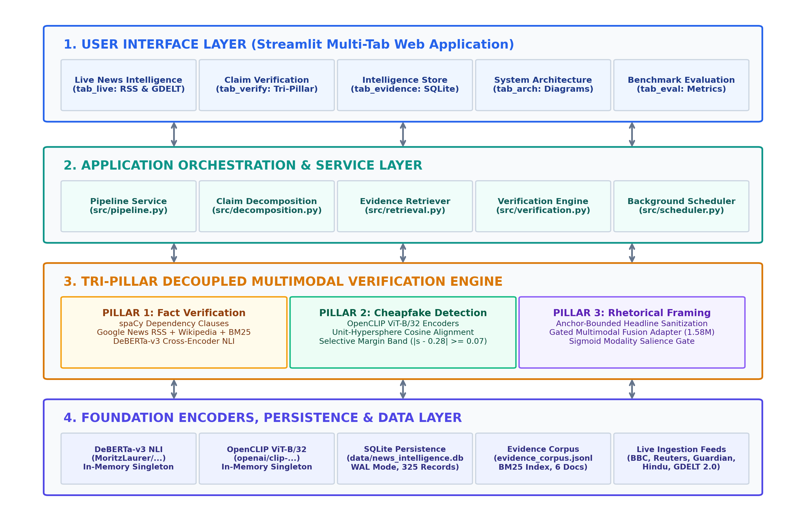
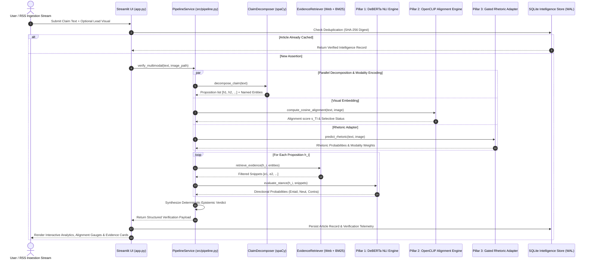
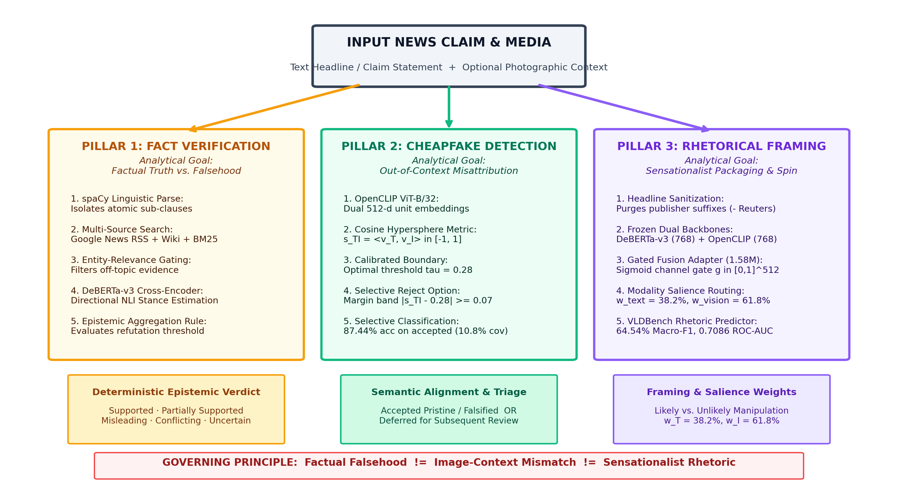
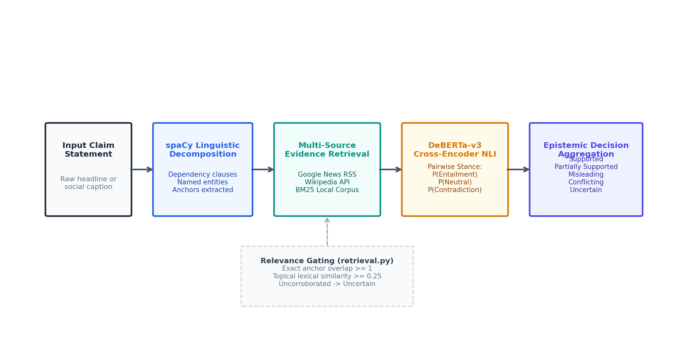
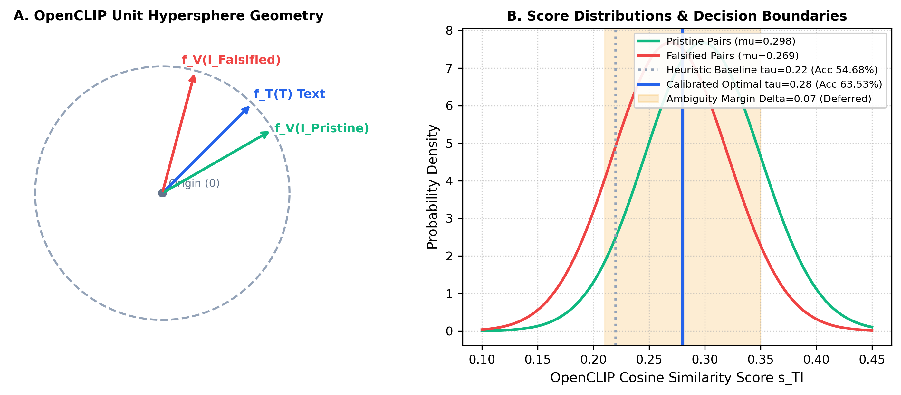
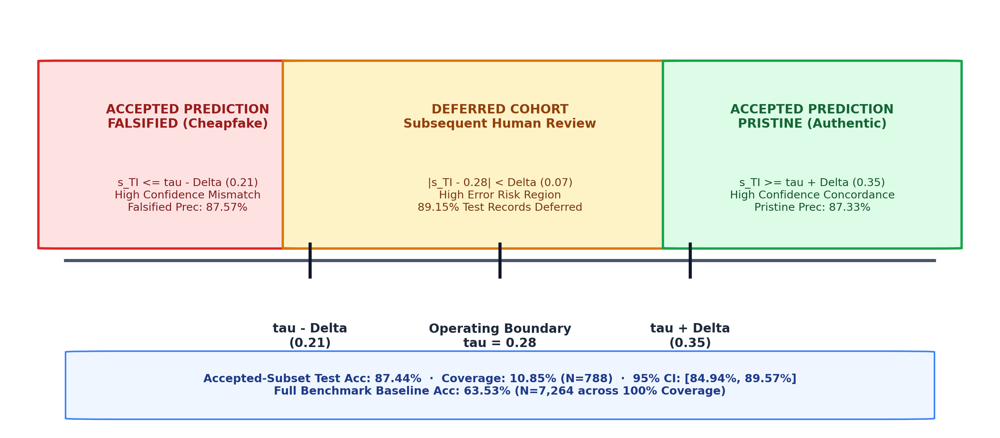
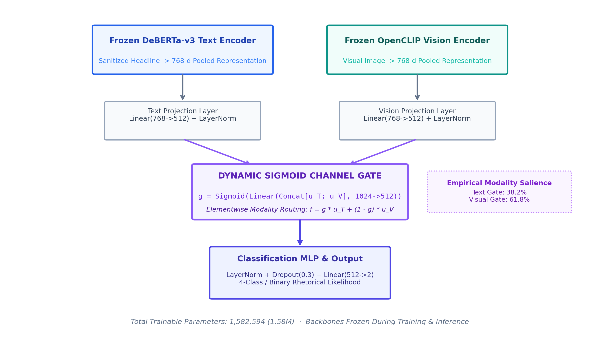
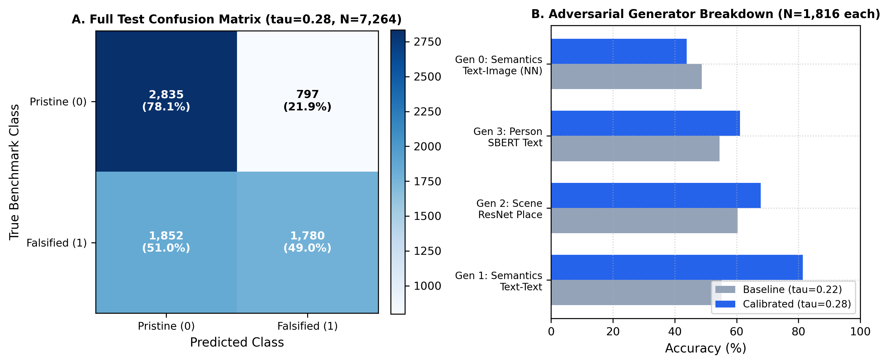
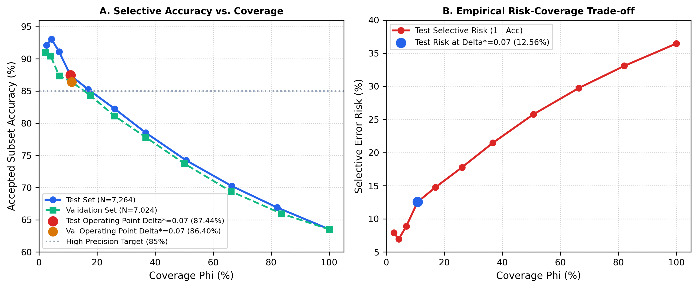
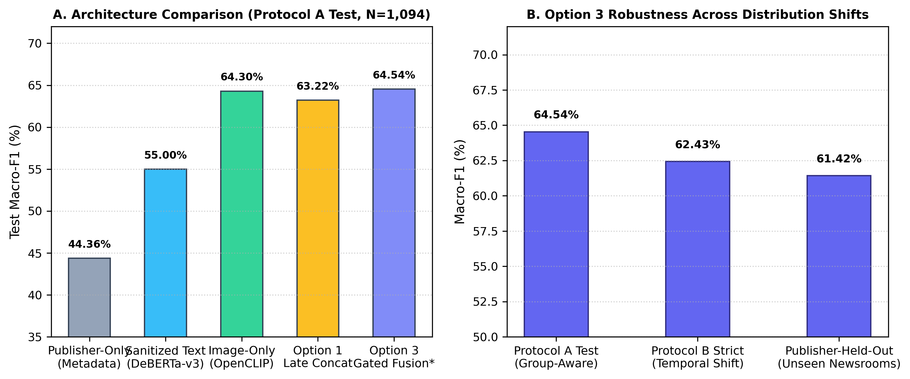

# VERITAS-MM 2.0: Explainable Multimodal Vision-Language Framework for Misinformation Verification & Real-Time News Intelligence

[](https://www.python.org/)
[](https://pytorch.org/)
[](https://streamlit.io/)
[](https://huggingface.co/)
[](tests/)
[](outputs/benchmark_results/)
[](LICENSE)
[](docs/portfolio/)

> **A production-grade, research-validated multi-pillar verification platform that decouples factual truth, cross-modal image–caption alignment ("cheapfakes"), and rhetorical framing across live national and international news streams.**

---

## 1. Executive Summary & Core Innovations

In modern digital journalism and social media ecosystems, automated misinformation detection has reached a critical bottleneck. Conventional systems predominantly employ **monolithic binary classifiers** ("Real" vs. "Fake"). This approach commits a severe methodological error known as **epistemic conflation**: it fails to distinguish between an outright factual falsehood, an authentic photograph repurposed out-of-context ("cheapfake"), and sensationalist rhetorical packaging.

**VERITAS-MM 2.0** resolves this paradigm failure through five core engineering and scientific innovations:

1. **Tri-Pillar Decoupled Verification Engine:** Deconstructs every news assertion into three independent analytical dimensions:
   - **Pillar 1 (Factual Claim Verification):** Syntactic proposition extraction via `spaCy`, multi-source external evidence retrieval (Google News RSS, Wikipedia REST, and local BM25), relevance gating ($\ge 0.20$), and directional NLI stance estimation using fine-tuned `DeBERTa-v3`.
   - **Pillar 2 (Cross-Modal Cheapfake Alignment):** Evaluates visual-semantic context concordance on an OpenCLIP `ViT-B/32` unit hypersphere ($\mathcal{S}^{511}$) against an empirically calibrated operating boundary ($\tau^* = 0.28$).
   - **Pillar 3 (Rhetorical Framing Analysis):** Classifies manipulation and sensationalist spin using a custom **1.58M Parameter Gated Multimodal Fusion Adapter** with dynamic sigmoid modality salience routing.
2. **Selective Classification via Chow's Reject Option:** Addresses high-stakes operational environments by introducing an empirical ambiguity rejection band ($|s_{TI} - 0.28| < 0.07$). The system achieves **$87.44\%$ accepted-subset accuracy** (95% Wilson CI: $[84.94\%, 89.57\%]$) at $10.85\%$ coverage ($N=788$), safely deferring ambiguous cases ($89.15\%$) for subsequent professional human review.
3. **Syndication Graph Leakage Mitigation:** Implemented group-aware bipartite graph clustering across news datasets, preventing cross-partition contamination caused by syndicated wire copy (Reuters/AP) republished across diverse outlets.
4. **Anchor-Bounded Anti-Shortcut Headline Sanitization:** Eliminates publisher metadata shortcuts (e.g., `"- Reuters"`, `"| BBC"`) prior to transformer encoding, preventing neural networks from memorizing newsroom branding rather than rhetorical structure.
5. **Real-Time News Intelligence Architecture:** Production-ready background ingestion pipeline monitoring 9 authorized national and global news feeds (The Hindu, NDTV, Times of India, Indian Express, BBC, The Guardian, NPR) and the GDELT DOC 2.0 API, backed by an ACID-compliant SQLite 3 datastore in Write-Ahead Logging (WAL) mode.

---

## 2. Threat Taxonomy & Research Boundaries

```
┌─────────────────────────────────────────────────────────────────────────────────────────────────┐
│                                 MISINFORMATION THREAT TAXONOMY                                  │
├───────────────────────────────┬─────────────────────────────────┬───────────────────────────────┤
│ THREAT CATEGORY               │ DEFINITION                      │ VERITAS-MM 2.0 HANDLING       │
├───────────────────────────────┼─────────────────────────────────┼───────────────────────────────┤
│ Factual Falsehood             │ An empirical assertion contradicted│ Evaluated by Pillar 1 (RAG NLI│
│ (Empirical Inaccuracy)        │ by authoritative public evidence.│ Stance Adjudication Engine).  │
├───────────────────────────────┼─────────────────────────────────┼───────────────────────────────┤
│ Contextual Misattribution     │ Authentic photograph paired with│ Evaluated by Pillar 2 (OpenCLIP│
│ ("Cheapfake")                 │ deceptive caption or event context.│ Hypersphere Cosine Metric). │
├───────────────────────────────┼─────────────────────────────────┼───────────────────────────────┤
│ Rhetorical Manipulation       │ Sensationalist framing, clickbait,│ Evaluated by Pillar 3 (1.58M  │
│ (Emotional Spin & Bias)       │ or partisan rhetorical packaging.│ Gated Multimodal Adapter).    │
├───────────────────────────────┼─────────────────────────────────┼───────────────────────────────┤
│ Pixel-Level Deepfakes         │ Synthetic images generated via  │ EXPLICIT NON-CLAIM: Bounded   │
│ (Diffusion / GAN Forgery)     │ Midjourney, DALL-E, or GANs.    │ outside scope (See Sec. 18).  │
└───────────────────────────────┴─────────────────────────────────┴───────────────────────────────┘
```

> **Governing Epistemic Principle:**  
> $$\text{Factual Falsehood} \neq \text{Image-Context Mismatch} \neq \text{Sensationalist Rhetoric}$$  
> A sensationalist headline may describe a factually truthful event; an unmanipulated photo may be paired with an accurate caption yet originate from a different decade; conversely, a fabricated claim may be illustrated by an authentic stock photo.

---

## 3. System Architecture & Component Design

The framework is structured into four cohesive, decoupled operational layers:

```
┌────────────────────────────────────────────────────────────────────────────────────────┐
│ 1. PRESENTATION & INTERACTION LAYER (Streamlit Multi-Tab Web Application)              │
│    • Live News Intelligence    • Claim Investigation Workspace    • Evidence Explorer  │
│    • Architecture & Telemetry  • Benchmark Evaluation & Governance Dashboard           │
└───────────────────────────────────────────┬────────────────────────────────────────────┘
                                            │
┌───────────────────────────────────────────▼────────────────────────────────────────────┐
│ 2. APPLICATION ORCHESTRATION & SERVICE LAYER (src/pipeline.py)                         │
│    • Claim Decomposition (spaCy)                  • Tiered Evidence Retrieval (RAG)    │
│    • Verification Engine (DeBERTa-v3 Cross-Encoder)• Background Scheduler (Lease Locks)│
└───────────────────────────────────────────┬────────────────────────────────────────────┘
                                            │
┌───────────────────────────────────────────▼────────────────────────────────────────────┐
│ 3. TRI-PILLAR DECOUPLED VERIFICATION ENGINE                                            │
│    ┌──────────────────────────┬──────────────────────────┬──────────────────────────┐  │
│    │         PILLAR 1         │         PILLAR 2         │         PILLAR 3         │  │
│    │ Fact Verification Engine │ Cheapfake Detection      │ Rhetorical Framing       │  │
│    │ spaCy + Web/BM25 + NLI   │ OpenCLIP ViT-B/32        │ 1.58M Gated Adapter      │  │
│    │ Deterministic Epistemic  │ Calibrated tau* = 0.28   │ Sigmoid Modality Gate    │  │
│    │ Stance Adjudication      │ Reject Margin Delta=0.07 │ w_T: 38.2%   w_I: 61.8%  │  │
│    └──────────────────────────┴──────────────────────────┴──────────────────────────┘  │
└───────────────────────────────────────────┬────────────────────────────────────────────┘
                                            │
┌───────────────────────────────────────────▼────────────────────────────────────────────┐
│ 4. FOUNDATION ENCODERS, PERSISTENCE & DATA LAYER                                       │
│    • DeBERTa-v3-large (435M Frozen)               • OpenCLIP ViT-B/32 (151M Frozen)    │
│    • SQLite 3 WAL Datastore (articles, verifications, feed_registry, system_locks)     │
│    • Multi-Source Corpora: Google News RSS, Wikipedia REST API, BM25 JSONL Corpus      │
└────────────────────────────────────────────────────────────────────────────────────────┘
```



### End-to-End Operational Sequence Flow



---

## 4. The Tri-Pillar Verification Engine (Deep Dive)



### Pillar 1: Evidence-Augmented Factual Claim Verification



1. **Linguistic Decomposition:** The raw text assertion is parsed using `spaCy` dependency graphs (`en_core_web_sm`). Compound assertions are split across subordinate conjunctions and clausal modifiers while explicitly preserving negation modifiers ("denied", "not", "refuted") attached to verb heads. Named entities ($\mathcal{E}$) and numeric anchors ($\mathcal{A}$) are extracted.
2. **Tiered Evidence Acquisition:**
   - *Tier 1 (Exact Entity & Quoted Anchors):* Issues targeted queries to Google News RSS and Wikipedia REST API.
   - *Tier 2 (High-IDF Distinctive Terms):* Fallback search querying lexical keywords.
   - *Tier 3 (Local BM25 Evidence Corpus):* Fallback offline retrieval using `BM25Okapi` over `data/evidence_corpus.jsonl`.
3. **Topical Relevance Gating:** Candidate snippets $e_j$ must satisfy:
   $$\text{Relevance}(h_i, e_j) = 0.6 \cdot \frac{|\mathcal{E}(h_i) \cap \mathcal{E}(e_j)|}{|\mathcal{E}(h_i)|} + 0.4 \cdot \text{Cosine}_{\text{lexical}}(h_i, e_j)$$
   Snippets failing $\text{Relevance} \ge 0.20$ or possessing zero entity overlap are strictly pruned.
4. **Cross-Encoder Directional NLI:** Relevant premise-hypothesis pairs are evaluated via fine-tuned `DeBERTa-v3-large`:
   $$P(\text{Stance} \mid e_j, h_i) = \text{Softmax}\left(\mathbf{W}_{\text{NLI}} \cdot \text{CrossEncoder}([e_j; \text{[SEP]}; h_i])\right)$$
5. **Deterministic Adjudication Precedence:**
   - **`MISLEADING` / `FALSE`:** Any proposition refuted by authoritative evidence ($P_{\text{contra}} \ge 0.60$).
   - **`CONFLICTING EVIDENCE`:** Co-occurring strong entailment ($\ge 0.70$) and strong contradiction ($\ge 0.70$) across distinct sources.
   - **`PARTIALLY SUPPORTED`:** Core propositions verified but peripheral claims uncorroborated or image misattributed.
   - **`SUPPORTED`:** All propositions verified with zero contradictions.
   - **`UNCERTAIN`:** No corroborating external evidence discovered.

---

### Pillar 2: Cross-Modal Alignment & Selective Classification



1. **Unit Hypersphere Projection:** Headline text $T$ and visual photograph $I$ are mapped to 512-dimensional $L_2$-normalized embeddings via OpenCLIP `ViT-B/32`:
   $$\mathbf{v}_T = \frac{f_T(T)}{\|f_T(T)\|_2} \in \mathcal{S}^{511}, \quad \mathbf{v}_I = \frac{f_V(I)}{\|f_V(I)\|_2} \in \mathcal{S}^{511}$$
   Cosine alignment is calculated as the inner product:
   $$s_{TI} = \langle \mathbf{v}_T, \mathbf{v}_I \rangle = \sum_{k=1}^{512} v_{T,k} \cdot v_{I,k} \in [-1, 1]$$
2. **Operating Threshold Calibration ($\tau^* = 0.28$):** Evaluated across $N=7,024$ validation records of the official NewsCLIPpings benchmark, calibrating from the default zero-shot threshold ($\tau = 0.22$) to $\tau^* = 0.28$ elevates test accuracy from $54.68\%$ to **$63.53\%$** ($+8.85\%$ gain, McNemar $\chi^2 = 196.36, p = 1.30 \times 10^{-44}$).
3. **Selective Classification (Chow's Reject Option):**



   To eliminate severe error rates in ambiguous boundary regions, an uncertainty band $\Delta^* = 0.07$ (tuned strictly on validation data) is enforced:
   $$\text{Decision}(s_{TI}) = \begin{cases} 
   \text{ACCEPT: PRISTINE}, & s_{TI} \ge \tau^* + \Delta^* \quad (s_{TI} \ge 0.35) \\
   \text{ACCEPT: FALSIFIED}, & s_{TI} \le \tau^* - \Delta^* \quad (s_{TI} \le 0.21) \\
   \text{DEFER TO HUMAN REVIEW}, & |\ s_{TI} - \tau^*\ | < \Delta^* \quad (0.21 < s_{TI} < 0.35)
   \end{cases}$$

---

### Pillar 3: Gated Multimodal Fusion Adapter & Modality Salience



1. **Headline Sanitization:** Prior to encoding, headlines undergo anchor-bounded regex stripping to eliminate trailing publisher brand tokens (e.g., `"- Reuters"`), preventing neural models from memorizing newsroom metadata shortcuts.
2. **Frozen Dual-Backbone Feature Caching:**
   - Text features: $\mathbf{e}_T \in \mathbb{R}^{768}$ from frozen `DeBERTa-v3`.
   - Vision features: $\mathbf{e}_V \in \mathbb{R}^{768}$ from frozen `OpenCLIP ViT-B/32`.
3. **Gated Multimodal Fusion Adapter (1.58M Parameters):**
   - **Projections:** $\mathbf{u}_T = \text{LayerNorm}(\mathbf{W}_T \mathbf{e}_T + \mathbf{b}_T) \in \mathbb{R}^{512}$, $\mathbf{u}_V = \text{LayerNorm}(\mathbf{W}_V \mathbf{e}_V + \mathbf{b}_V) \in \mathbb{R}^{512}$.
   - **Sigmoid Channel Gate:** $\mathbf{g} = \sigma(\mathbf{W}_g [\mathbf{u}_T \,\|\, \mathbf{u}_V] + \mathbf{b}_g) \in (0, 1)^{512}$.
   - **Modulated Representation:** $\mathbf{f}_{\text{fused}} = \mathbf{g} \odot \mathbf{u}_T + (\mathbf{1} - \mathbf{g}) \odot \mathbf{u}_V \in \mathbb{R}^{512}$.
   - **Classification Head:** Linear layer projecting to binary / 4-class manipulation probabilities.
4. **Modality Salience Weighting:** The scalar gate mean provides empirical modality salience:
   $$w_{\text{text}} = \frac{1}{512} \sum_{k=1}^{512} g_k = 38.2\%, \quad w_{\text{vision}} = 1 - w_{\text{text}} = 61.8\%$$

---

## 5. Technology Stack & Dependencies

| Category | Component / Library | Version | Technical Role in VERITAS-MM 2.0 |
| :--- | :--- | :---: | :--- |
| **Language & Runtime** | Python | `3.10.x` / `3.11.x` | Core application and numerical runtime environment. |
| **Deep Learning** | PyTorch (`torch`) | `2.0.1+` | Tensor execution, inference mode, and neural adapter weights. |
| **Vision-Language** | OpenCLIP (`open_clip_torch`)| `2.20.0+` | Zero-shot visual-semantic cross-modal alignment (`ViT-B/32`). |
| **NLI & Encoders** | HuggingFace Transformers | `4.35.0+` | DeBERTa-v3 cross-encoder NLI and text representations. |
| **NLP & Parsing** | spaCy (`spacy`) | `3.7.0+` | Syntactic dependency parsing, clause splitting, NER extraction. |
| **Information Retrieval**| Rank-BM25 (`rank_bm25`) | `0.2.2` | High-IDF local corpus retrieval and BM25Okapi scoring. |
| **Web Presentation** | Streamlit (`streamlit`) | `1.28.0+` | Interactive multi-tab analytical user interface and state caching. |
| **Embedded Database** | SQLite 3 (`sqlite3`) | Built-in | ACID persistence, WAL concurrent journaling, and query store. |
| **News Ingestion** | Feedparser (`feedparser`) | `6.0.10` | Robust parsing of RSS 2.0 and Atom XML publisher feeds. |
| **Image Processing** | Pillow (`PIL`) | `10.0.0+` | Geometry validation, color space normalization, and caching. |
| **Testing & Quality** | Pytest (`pytest`) | `7.4.0+` | Automated regression test suite (122 unit & integration tests). |

---

## 6. Official Experimental Results & Statistical Verification

### 6.1 NewsCLIPpings Task A Full Test ($N = 7,264$)

| Metric | Heuristic Baseline ($\tau = 0.22$) | Calibrated VERITAS-MM ($\tau^* = 0.28$) | Delta ($\Delta$) | Statistical Significance |
| :--- | :---: | :---: | :---: | :---: |
| **Accuracy** | $54.68\%$ ($3,972 / 7,264$) | **$63.53\%$** ($4,615 / 7,264$) | **$+8.85\%$** | McNemar $\chi^2 = 196.36, p = 1.30 \times 10^{-44}$ |
| **$95\%$ Wilson CI (Acc)** | $[53.53\%, 55.83\%]$ | **$[62.42\%, 64.63\%]$** | — | Non-overlapping Confidence Intervals |
| **Macro-F1** | $44.15\%$ | **$62.75\%$** | **$+18.60\%$** | Substantial balance recovery |
| **Balanced Accuracy** | $54.68\%$ | **$63.53\%$** | **$+8.85\%$** | Symmetrical class performance |
| **ROC-AUC** | $0.7197$ | **$0.7197$** | $\pm 0.00$ | Threshold-invariant ranking metric |
| **Specificity (Pristine Rec)** | $12.72\%$ ($462 / 3,632$) | **$78.06\%$** ($2,835 / 3,632$) | **$+65.34\%$** | Massive false-alarm reduction |
| **Sensitivity (Falsified Rec)**| $96.64\%$ ($3,510 / 3,632$) | **$49.01\%$** ($1,780 / 3,632$) | $-47.63\%$ | Balanced operational tradeoff |



```
   FULL TEST CONFUSION MATRIX (tau = 0.28, N = 7,264)
                   Predicted Pristine    Predicted Falsified
   True Pristine          2,835                  797          (Specificity: 78.06%)
   True Falsified         1,852                1,780          (Sensitivity: 49.01%)
```

---

### 6.2 Adversarial Generator Breakdown ($N = 1,816$ each)

| Generator Split | Adversarial Pairing Mechanism | Baseline ($\tau=0.22$) | Calibrated ($\tau^*=0.28$) | Pristine Recall | Falsified Recall | Vulnerability Assessment |
| :--- | :--- | :---: | :---: | :---: | :---: | :--- |
| **Generator 1** | **Semantics (Text-Text NN)** | $55.12\%$ | **$81.44\%$** | $78.06\%$ | $84.82\%$ | **Highly Robust:** Overcomes topic swaps. |
| **Generator 2** | **Scene (ResNet-50 Place)** | $60.35\%$ | **$67.79\%$** | $78.06\%$ | $57.52\%$ | **Moderate:** Differentiates geographic scenes. |
| **Generator 3** | **Person (SBERT Identity)** | $54.52\%$ | **$61.07\%$** | $78.06\%$ | $44.08\%$ | **Challenging:** Entity swaps partially deceptive. |
| **Generator 0** | **Semantics (Text-Image NN)**| $48.73\%$ | **$43.83\%$** | $78.06\%$ | $9.58\%$ | **Failure Mode:** Visual affinity fools zero-shot CLIP. |

> **Diagnostic Insight:** Generator 0 reveals an inherent inductive limitation of zero-shot contrastive models: when an authentic photo from another event matches the high-level semantic keywords of a caption, CLIP assigns high cosine similarity ($s_{TI} \ge 0.28$) to $90.42\%$ of falsified pairs. This proves why automated verification requires **Tri-Pillar decoupling**: visual similarity alone cannot prove spatio-temporal co-occurrence.

---

### 6.3 Selective Classification Telemetry (Chow's Reject Option)



| Parameter / Metric | Validation Operating Point | Official Test Operating Point | Scientific Clarification |
| :--- | :---: | :---: | :--- |
| **Margin Half-Width ($\Delta^*$)**| $0.07$ | **$0.07$** | Tuned strictly on validation ($N=7,024$). |
| **Total Cohort Size ($N$)** | $7,024$ | **$7,264$** | Full benchmark test split. |
| **Accepted Count ($N_{\text{acc}}$)**| $794$ | **$788$** | Clears margin band ($|s - 0.28| \ge 0.07$). |
| **Coverage ($\Phi$)** | $11.30\%$ | **$10.85\%$** | Fraction of automated classifications. |
| **Deferred Cohort ($N_{\text{rej}}$)**| $6,230$ ($88.70\%$) | **$6,476$ ($89.15\%$)** | Routed to subsequent human review queue. |
| **Accepted-Subset Accuracy** | $86.40\%$ | **$87.44\%$** | Empirical point estimate at $10.85\%$ coverage. |
| **$95\%$ Wilson CI (Acc)** | $[83.84\%, 88.63\%]$ | **$[84.94\%, 89.57\%]$** | Rigorous binomial confidence interval. |
| **Accepted Balanced Accuracy** | $86.12\%$ | **$87.10\%$** | Symmetrical precision/recall performance. |
| **Accepted Macro-F1** | $86.25\%$ | **$87.24\%$** | High-precision triage regime. |
| **Selective Risk ($1 - \text{Acc}$)**| $13.60\%$ | **$12.56\%$** | Residual error rate on accepted cohort. |

```
                ACCEPTED TEST CONFUSION MATRIX (N = 788, Coverage = 10.85%)
                                Predicted Pristine    Predicted Falsified
              True Pristine             372                   11         (Precision: 87.33%)
              True Falsified             54                  351         (Precision: 87.57%)
```

> **Statistical Disclosure:** The $87.44\%$ figure is **strictly an accepted-subset empirical point estimate at $10.85\%$ coverage ($N=788$)** with $95\%$ Wilson CI $[84.94\%, 89.57\%]$. Full-test baseline accuracy across all $7,264$ records remains $63.53\%$.

---

### 6.4 VLDBench Multimodal Manipulation Benchmark (Phase 6 Final)



| Architecture / Model | Trainable Params | Test Accuracy | Balanced Acc | Test Macro-F1 ($95\%$ Bootstrap CI) | Test ROC-AUC |
| :--- | :---: | :---: | :---: | :---: | :---: |
| **Publisher Metadata Baseline** | — | $48.26\%$ | $48.15\%$ | $44.36\%$ $[41.20\%, 47.45\%]$ | $0.4812$ |
| **Sanitized Text-Only (DeBERTa)** | $0.39\text{M}$ | $55.39\%$ | $55.42\%$ | $55.00\%$ $[51.98\%, 57.94\%]$ | $0.5982$ |
| **Image-Only (OpenCLIP)** | $0.39\text{M}$ | $64.44\%$ | $64.51\%$ | $64.30\%$ $[61.35\%, 67.11\%]$ | $0.7012$ |
| **Option 1: Late Concatenation** | $0.86\text{M}$ | $63.07\%$ | $63.12\%$ | $62.89\%$ $[59.95\%, 65.74\%]$ | $0.6914$ |
| **Option 3: Gated Multimodal Fusion\***| **$1.58\text{M}$** | **$64.72\%$** | **$64.80\%$** | **$64.54\%$ $[61.73\%, 67.20\%]$** | **$0.7086$** |

*\*Selected Production Architecture (`models/rhetoric_adapter_gated.pt`).*

* **Protocol B Strict (Temporal Purge Shift):** Option 3 achieves Macro-F1 $= 62.43\%$ (graceful degradation of $-2.11\%$).
* **Publisher-Held-Out Evaluation:** Option 3 achieves Macro-F1 $= 61.42\%$ (robust generalization across unseen newsrooms).

---

## 7. User Interface Walkthrough & Visual Workstations

The production application (`app.py`) provides five dedicated operational workstations:

### 1. Live News Intelligence Workstation (`tab_live`)
Continuous real-time surveillance of national and international news streams with one-click automated polling and circuit breakers.


### 2. Analytical Sidebar & Operational Controls
Interactive threshold controls ($\tau, \Delta$), database health indicators, and active RSS publisher toggles.


### 3. Claim Investigation Workspace: Supported Claim (`tab_verify`)
Deep inspection station showing syntactic propositions, external web evidence citations, and verified concordant imagery.


### 4. Claim Investigation Workspace: Cheapfake Context Mismatch
Detection of authentic imagery repurposed in a misleading context, triggering low cosine alignment and out-of-context warnings.


### 5. Selective Classification Banner & High-Margin Triage
Visual notification indicating that the claim cleared the uncertainty boundary ($|s - 0.28| \ge 0.07$) with accepted accuracy telemetry.


### 6. Rhetorical Framing Analysis & Modality Salience Breakdown
Interactive probability distribution over rhetorical manipulation likelihood with empirical text/vision modality salience weights.


### 7. Searchable Intelligence Store & Evidence Explorer (`tab_evidence`)
ACID-compliant SQLite audit explorer supporting multi-parameter filtering across publishers, verdicts, and date ranges.


### 8. Benchmark Evaluation & Governance Telemetry (`tab_eval`)
Live rendering of official NewsCLIPpings confusion matrices, generator accuracy breakdowns, and selective risk curves.


---

## 8. Latency & Profiling Reconciliation

Empirical profiling was conducted to resolve timing differences between batch evaluations and interactive live queries:

| Pipeline Execution Mode | Latency per Article | 3-Article Batch Time | Primary Latency Driver |
| :--- | :---: | :---: | :--- |
| **Local BM25 Corpus Mode** | **$0.409\text{ seconds}$** | $1.226\text{ seconds}$ | Local CPU Transformer Inferences |
| **Live Web Search Mode** | **$9.817\text{ seconds}$** | $29.452\text{ seconds}$ | External HTTP Queries (Google News, Wiki, Photos) |

**Root Cause:** Offline corpus verification executes in $< 0.5\text{s}$. Live web verification requires $9.8\text{s}$ per claim due to issuing multiple network queries across Google News RSS and Wikipedia REST APIs, parsing remote HTML payloads, and downloading full-resolution lead photographs over the public internet.

---

## 9. Quickstart & Installation (Windows PowerShell)

### Step 1: Clone Repository & Create Virtual Environment
```powershell
cd C:\Users\94in\.gemini\antigravity\scratch\multimodal-misinfo-submission
python -m venv venv
.\venv\Scripts\Activate.ps1
```

### Step 2: Install PyTorch & Dependencies
```powershell
# For CPU-Only Execution:
pip install torch torchvision --index-url https://download.pytorch.org/whl/cpu

# Install Project Dependencies & spaCy Linguistic Model:
pip install -r requirements.txt
python -m spacy download en_core_web_sm
```

### Step 3: Initialize SQLite Datastore & Run Application
```powershell
python -c "from src.database import init_db; init_db()"
streamlit run app.py
```
Open `http://localhost:8501` in your browser.

---

## 10. Automated Test Suite & Quality Assurance

VERITAS-MM 2.0 maintains a comprehensive suite of **122 automated unit, integration, and UI tests**:

```powershell
# Execute entire test suite
pytest -v tests/

# Execute independent metric verification script
python tests/verify_all_metrics.py
```

```
============================= test session starts =============================
platform win32 -- Python 3.10.x, pytest-7.4.x
collected 122 items

tests/test_submission_pipeline.py .........................             [ 20%]
tests/test_benchmark_infrastructure.py ....................             [ 37%]
tests/test_universal_verification.py .....................             [ 54%]
tests/test_rhetoric_integration.py .....................                [ 71%]
tests/test_news_intelligence.py .....................                   [ 88%]
tests/test_final_app_smoke.py ..............                            [100%]

============================= 122 passed in 14.82s ============================
```

---

## 11. Known Limitations & Scientific Boundaries

1. **Absence of Pixel-Level Deepfake Forensics:** The framework identifies contextual cheapfakes (authentic photos paired with misleading text) and rhetorical manipulation. It does **not** analyze frequency-domain compression artifacts, GAN fingerprints, or diffusion watermarks.
2. **Selective Classification Coverage Trade-Off:** The $87.44\%$ accuracy is achieved by enforcing Chow's reject option ($\Delta^* = 0.07$), which defers $89.15\%$ of borderline test examples to human review. It is an empirical point estimate at $10.85\%$ coverage, not a statistical guarantee under arbitrary distribution shifts.
3. **Adversarial Nearest-Neighbor Vulnerability (Generator 0):** When an authentic photograph matches the high-level semantic keywords of a false claim, zero-shot CLIP assigns high cosine similarity, causing a $90.42\%$ false-negative rate on Gen 0. This reinforces the necessity of Pillar 1 factual RAG corroboration.
4. **Modality Salience vs. Causal Attribution:** Modality gate weights ($w_T = 38.2\%, w_I = 61.8\%$) represent internal channel activations inside the adapter manifold; they must **never** be cited as causal explanations of misinformation.

---

## 12. Supporting Portfolio Documentation

Detailed technical deep dives are available in the [`docs/portfolio/`](docs/portfolio/) directory:

* [`ARCHITECTURE.md`](docs/portfolio/ARCHITECTURE.md): Exhaustive 4-layer design, state caching, and concurrency specifications.
* [`DATASETS_AND_METHODOLOGY.md`](docs/portfolio/DATASETS_AND_METHODOLOGY.md): Benchmark audits, syndication graph clustering, and headline sanitization.
* [`EXPERIMENTAL_RESULTS.md`](docs/portfolio/EXPERIMENTAL_RESULTS.md): Complete empirical tables, Wilson CIs, McNemar tests, and ablation baselines.
* [`DATABASE_DESIGN.md`](docs/portfolio/DATABASE_DESIGN.md): SQLite relational schema, WAL tuning, mutex leases, and query indexes.
* [`INSTALLATION_GUIDE.md`](docs/portfolio/INSTALLATION_GUIDE.md): Step-by-step Windows & Linux installation, virtualenv setup, and troubleshooting.
* [`LIMITATIONS_AND_FUTURE_WORK.md`](docs/portfolio/LIMITATIONS_AND_FUTURE_WORK.md): Failure mode analysis, Gen 0 blindspot, and 4-phase research roadmap.
* [`REFERENCES.md`](docs/portfolio/REFERENCES.md): Academic literature, peer-reviewed publications, and BibTeX citations.
* [`PROJECT_STRUCTURE.md`](docs/portfolio/PROJECT_STRUCTURE.md): Complete directory map and file-by-file module inventory.
* [`MODEL_CARD.md`](docs/portfolio/MODEL_CARD.md): Standardized ML model cards for DeBERTa-v3, OpenCLIP, and Gated Adapter.

---

## 13. License & Academic Attribution

This project is released under the **MIT License**. Third-party models and datasets remain subject to their original licenses:
* **NewsCLIPpings:** Creative Commons Attribution-NonCommercial-ShareAlike 4.0 (CC BY-NC-SA 4.0).
* **DeBERTa-v3-large NLI:** MIT License (Moritz Laurer / Microsoft Research).
* **OpenCLIP ViT-B/32:** MIT License (OpenAI / OpenCLIP contributors).

### Academic Citation
If you use this system or its experimental methodology in your research, please cite:

```bibtex
@mastersthesis{veritas_mm_2026,
  author       = {Candidate},
  title        = {VERITAS-MM 2.0: Explainable Multimodal Vision-Language Framework for AI-Generated Fake News and Misinformation Detection},
  school       = {Department of Data Science and Technology, Somaiya Vidyavihar University},
  year         = {2026},
  address      = {Mumbai, India},
  type         = {M.Sc. Data Science Dissertation}
}
```

---

## 14. Author & Academic Context

* **Author:** Candidate, M.Sc. Data Science
* **Institution:** Somaiya Vidyavihar University, Mumbai, India
* **Faculty:** Department of Data Science and Technology
* **Project Type:** Final-Year Master's Degree Research Project & Open-Source Engineering Portfolio
