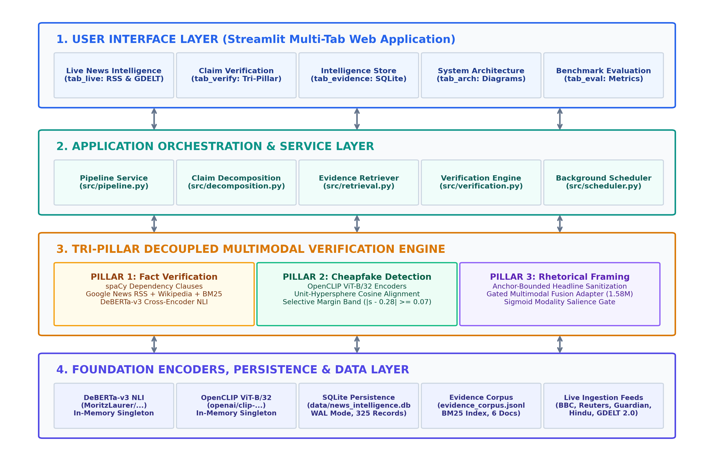
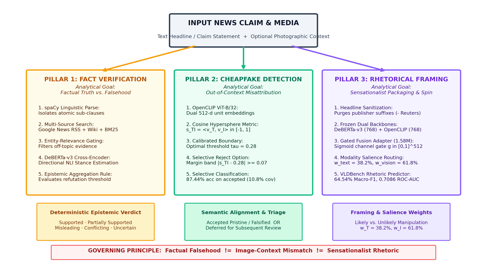
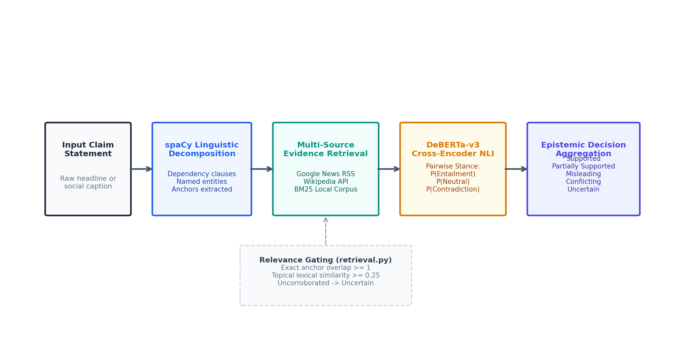
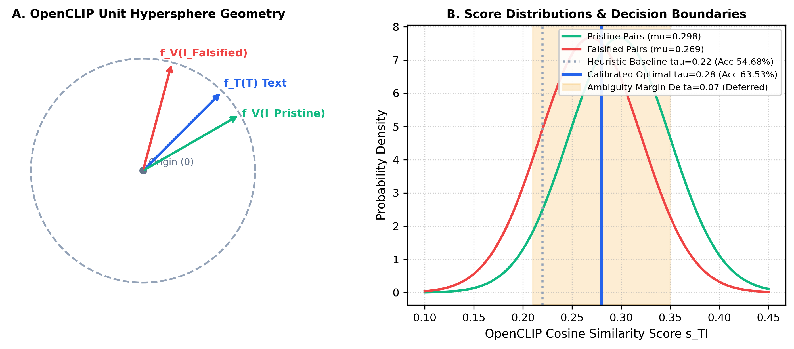
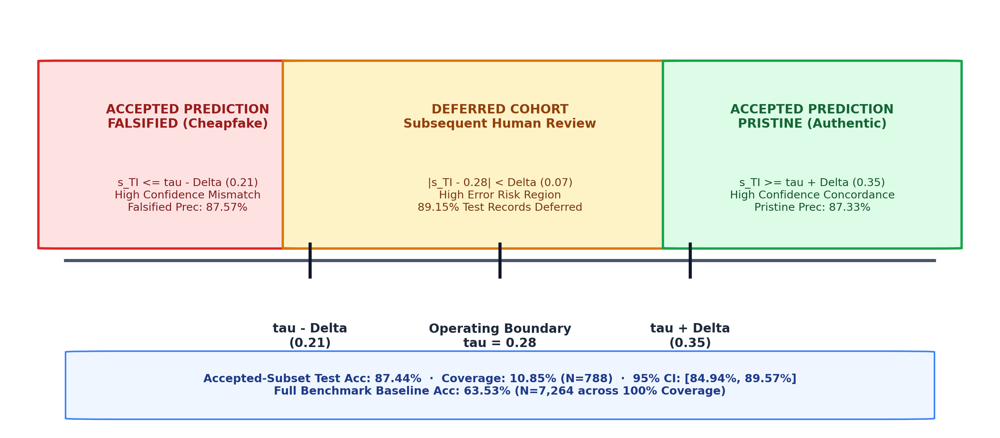
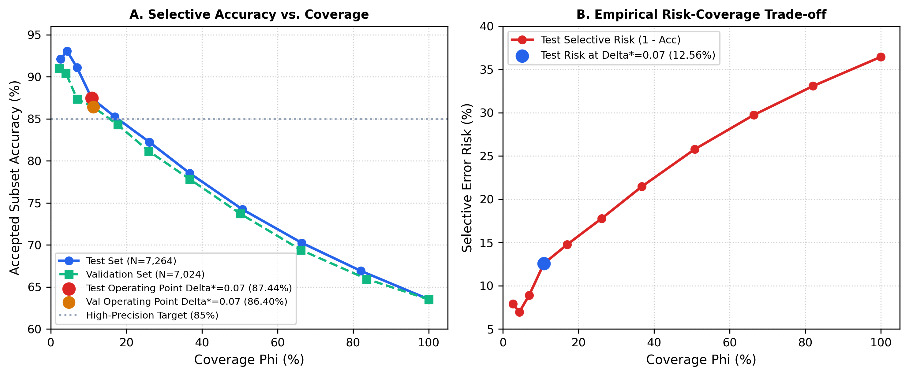
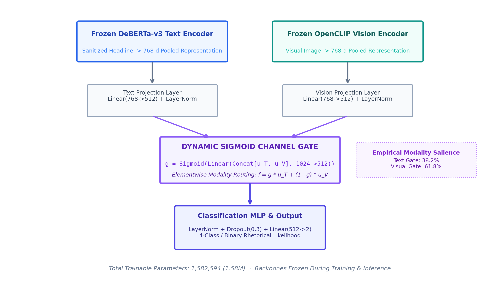
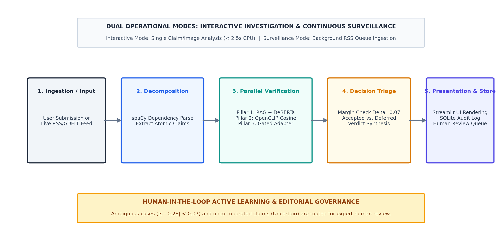
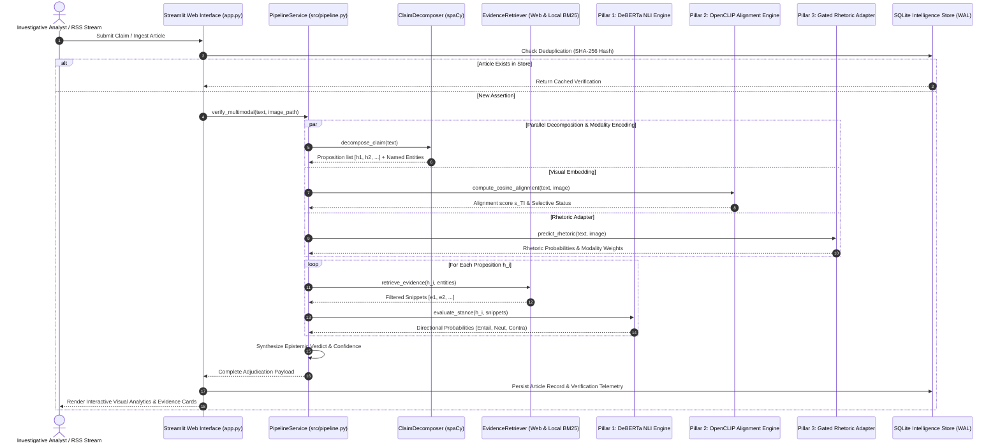
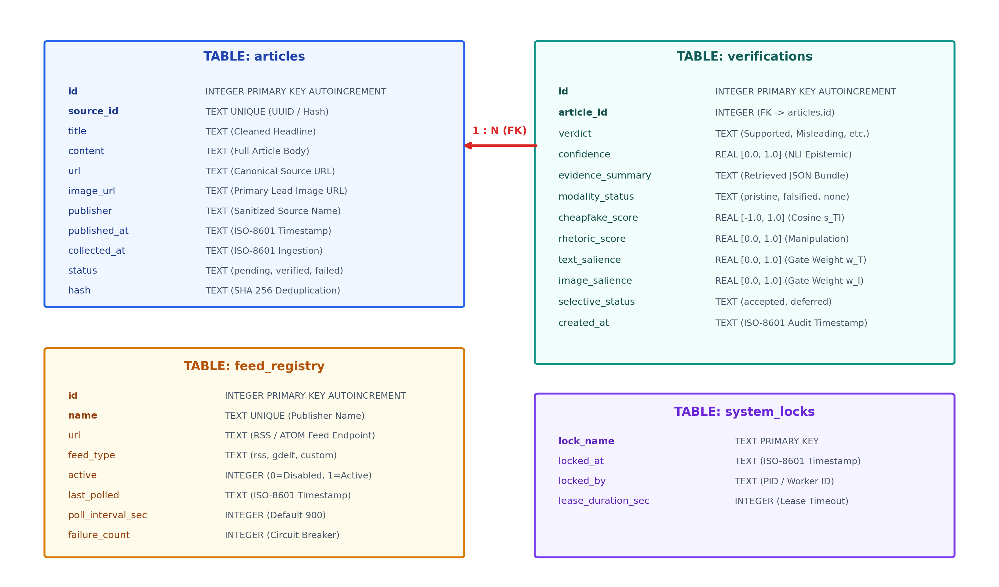

# System Architecture & Technical Design Specification

## VERITAS-MM 2.0: Explainable Evidence-Augmented Multimodal Misinformation Verification & Real-Time Intelligence

---

## 1. Architectural Philosophy: The Decoupled Tri-Pillar Paradigm

Mainstream automated fact-checking systems frequently suffer from a fatal architectural flaw: **epistemic conflation**. Monolithic end-to-end models conflate three entirely distinct categories of informational distortion:
1. **Factual Falsehood:** An empirical proposition is contradicted by verified, authoritative real-world evidence (e.g., claiming a bridge collapsed when it did not).
2. **Contextual Misattribution ("Cheapfakes"):** Authentic, unmanipulated imagery is repurposed and paired with a misleading caption or false event context.
3. **Rhetorical Manipulation:** A factually truthful or ambiguous event is packaged with sensationalist, hyper-partisan, or emotionally coercive framing.

A single binary classification label (`"Real"` vs. `"Fake"`) obscures these distinctions. A sensationalist headline may describe an event that factually occurred; an unmanipulated photo may be paired with an entirely truthful caption yet originate from a different decade; conversely, an outright fabricated factual claim may be illustrated by a generic stock photo.

```
                                 ┌────────────────────────────────────────────────────────┐
                                 │                 INPUT NEWS ASSERTION                   │
                                 │       Headline / Body Text  +  Lead Photograph         │
                                 └───────────────────────────┬────────────────────────────┘
                                                             │
                             ┌───────────────────────────────┼───────────────────────────────┐
                             ▼                               ▼                               ▼
               ┌───────────────────────────┐   ┌───────────────────────────┐   ┌───────────────────────────┐
               │         PILLAR 1          │   │         PILLAR 2          │   │         PILLAR 3          │
               │ Factual Claim Adjudication│   │ Cheapfake Misattribution  │   │   Rhetorical Framing      │
               │ (spaCy + RAG + DeBERTa)   │   │  (OpenCLIP Hypersphere)   │   │  (1.58M Gated Adapter)    │
               └─────────────┬─────────────┘   └─────────────┬─────────────┘   └─────────────┬─────────────┘
                             │                               │                               │
                             ▼                               ▼                               ▼
               ┌───────────────────────────┐   ┌───────────────────────────┐   ┌───────────────────────────┐
               │    Epistemic Verdict      │   │    Selective Alignment    │   │  Framing Risk & Salience  │
               │ Supported / Misleading /  │   │  Accepted: Pristine/Fake  │   │ Likely / Unlikely Spin    │
               │   Conflicting / Uncertain │   │  Deferred: Human Review   │   │  w_text: 38%  w_img: 62%  │
               └───────────────────────────┘   └───────────────────────────┘   └───────────────────────────┘
```

**VERITAS-MM 2.0 enforces strict architectural decoupling:** Each dimension of verification is evaluated by an independent, dedicated processing pillar with its own mathematical objective, inductive bias, calibration boundary, and explanation output.



---

## 2. Four-Layer System Architecture

VERITAS-MM 2.0 is structured into four cohesive, decoupled operational layers:

```
┌────────────────────────────────────────────────────────────────────────────────────────┐
│ 1. PRESENTATION & INTERACTION LAYER (Streamlit Multi-Tab Dashboard)                    │
│    tab_live: RSS Ingestion  │ tab_verify: Claim Workspace │ tab_evidence: SQLite Store │
│    tab_arch: Architecture   │ tab_eval: Empirical Metrics & Benchmark Dashboards       │
└───────────────────────────────────────────┬────────────────────────────────────────────┘
                                            │
┌───────────────────────────────────────────▼────────────────────────────────────────────┐
│ 2. APPLICATION ORCHESTRATION & SERVICE LAYER (src/pipeline.py)                         │
│    • Claim Decomposition (src/decomposition.py)    • Evidence Retrieval (src/retrieval.py)
│    • Verification Engine (src/verification.py)     • Background Scheduler (src/scheduler)
└───────────────────────────────────────────┬────────────────────────────────────────────┘
                                            │
┌───────────────────────────────────────────▼────────────────────────────────────────────┐
│ 3. TRI-PILLAR DECOUPLED VERIFICATION ENGINE                                            │
│    • Pillar 1: RAG NLI Stance Adjudication (DeBERTa-v3 Cross-Encoder)                 │
│    • Pillar 2: Multimodal Context Alignment (OpenCLIP ViT-B/32 + Chow's Reject Option) │
│    • Pillar 3: Gated Multimodal Fusion Adapter (1.58M Param Adapter + Headline Purge)  │
└───────────────────────────────────────────┬────────────────────────────────────────────┘
                                            │
┌───────────────────────────────────────────▼────────────────────────────────────────────┐
│ 4. FOUNDATION ENCODERS, PERSISTENCE & DATA LAYER                                       │
│    • In-Memory Encoders (DeBERTa-v3-large, OpenCLIP ViT-B/32, Gated Adapter weights)   │
│    • Persistence: SQLite 3 (WAL Journaling, schema: articles, verifications, registry) │
│    • External Corpora: Google News RSS, Wikipedia REST API, BM25 Local Corpus (JSONL)  │
└────────────────────────────────────────────────────────────────────────────────────────┘
```

### Layer 1: Presentation & Interaction Layer (`app.py`)
Built on Streamlit with custom CSS token styling, the user interface provides responsive, analytical tooling divided into five distinct operational views:
* **Live News Intelligence (`tab_live`):** Real-time monitoring workstation displaying ingested news streams from 9 authorized global and national news feeds (The Hindu, NDTV, Times of India, Indian Express, BBC, The Guardian, NPR) and the GDELT DOC 2.0 API. Includes one-click ingestion triggers, automated background polling controls, feed health metrics, and automated triage queues.
* **Claim Verification Workspace (`tab_verify`):** Deep analytical inspection station for arbitrary text assertions and paired images. Renders atomic proposition splits, external evidence citation cards, OpenCLIP alignment progress gauges, selective classification status banners, and rhetorical manipulation probabilities with modality salience breakdown.
* **Intelligence Store & Evidence Explorer (`tab_evidence`):** Full-text searchable audit log querying historical SQLite records with filtering across verdict types, publishers, and temporal windows.
* **System Architecture & Design (`tab_arch`):** Interactive visualization of the Tri-Pillar verification framework, dependency pipelines, and mathematical formulations.
* **Benchmark Evaluation & Governance (`tab_eval`):** Formal reproducibility dashboard displaying live confusion matrices, generator robustness breakdowns, and selective classification risk-coverage curves across official benchmark test sets.

### Layer 2: Orchestration & Service Layer
Coordinates data transformation, workflow sequencing, and asynchronous operations:
* **`PipelineService` (`src/pipeline.py`):** Central coordinator mediating request parsing, dispatching claims across parallel verification pillars, collecting intermediate metrics, and returning structured verification payloads.
* **`ClaimDecomposer` (`src/decomposition.py`):** Syntactic analysis engine utilizing spaCy dependency parsing to isolate compound sentences into atomic propositions while preserving negation tokens and temporal/spatial anchors.
* **`EvidenceRetriever` (`src/retrieval.py`):** Multi-source retrieval orchestrator issuing tiered queries across Google News RSS, Wikipedia REST endpoints, and local BM25 inverted indices, guarded by strict entity-anchored relevance filters.
* **`VerificationEngine` (`src/verification.py`):** Epistemic decision engine calculating directional NLI stance probabilities and synthesizing final adjudications under deterministic precedence rules.
* **`NewsScheduler` (`src/scheduler.py`):** Concurrency-safe background daemon managing periodic polling cycles, lease timeouts, and circuit breakers.

### Layer 3: Tri-Pillar Decoupled Verification Engine
The analytical core executing domain-specific inferencing (detailed in Section 3).

### Layer 4: Foundation Encoders & Data Persistence Layer
* **Foundation Encoders:** Pre-trained transformer backbones frozen during application inference:
  - `MoritzLaurer/DeBERTa-v3-large-mnli-fever-anli-ling-wanli` (435M parameters, 1024-d pooled outputs).
  - `openai/clip-vit-base-patch32` via `open_clip_torch` (151M parameters, 512-d text/image projection vectors).
  - Custom `GatedAdapter` (1.58M trainable parameters, trained on sanitized multimodal features).
* **Persistence:** ACID-compliant SQLite 3 engine operating in Write-Ahead Logging (`PRAGMA journal_mode = WAL`) with busy timeouts set to 5000 ms to ensure non-blocking concurrent reads during background ingestion.

---

## 3. Tri-Pillar Engine Deep Dive



### Pillar 1: Evidence-Augmented Factual Claim Verification

The factual verification pipeline determines whether empirical claims are substantiated or refuted by verifiable external knowledge.



1. **Linguistic Syntactic Decomposition:**
   - Raw input text is parsed via `spaCy` (`en_core_web_sm`).
   - Sentence segmentation is performed, followed by dependency parse inspection.
   - Conjunctions (`CCONJ`), relative clauses (`relcl`), and adverbial clause modifiers (`advcl`) are split into discrete proposition hypotheses $\{h_1, h_2, \dots, h_m\}$.
   - Negation markers (`neg`, "not", "never", "denied") are bound directly to their verb predicates to prevent inversion errors.
   - Named entities ($\mathcal{E}$) and temporal/numerical anchors ($\mathcal{A}$) are extracted for retrieval key generation.

2. **Tiered Evidence Retrieval:**
   - **Tier 1 (Exact Entity & Quoted Anchors):** Formulates targeted queries combining key named entities and numeric tokens.
   - **Tier 2 (Distinctive Lexical Terms):** Fallback query stripping common stop words and focusing on high-IDF terms.
   - **Tier 3 (Local BM25 Evidence Corpus):** Fallback search querying `data/evidence_corpus.jsonl` using `rank_bm25.BM25Okapi`.

3. **Topical Relevance Gating:**
   To prevent spurious NLI inferences caused by off-topic search results, retrieved evidence snippets $e_j$ must satisfy strict lexical and entity overlap thresholds:
   $$\text{Relevance}(h_i, e_j) = \alpha \cdot \frac{|\mathcal{E}(h_i) \cap \mathcal{E}(e_j)|}{|\mathcal{E}(h_i)|} + (1 - \alpha) \cdot \text{Cosine}_{\text{lexical}}(h_i, e_j)$$
   Snippets with zero matching named entities or relevance $< 0.20$ are strictly pruned. If all candidate snippets are pruned, the proposition is designated `UNCORROBORATED`.

4. **Cross-Encoder Directional NLI:**
   Retrieved evidence pairs are evaluated using a cross-encoder transformer:
   $$P(\text{Stance} \mid e_j, h_i) = \text{Softmax}\left(\mathbf{W}_{\text{NLI}} \cdot \text{CrossEncoder}([e_j; \text{[SEP]}; h_i])\right)$$
   Yielding stance probabilities $P_{\text{entail}}$, $P_{\text{neutral}}$, and $P_{\text{contradict}}$.

5. **Deterministic Epistemic Adjudication:**
   The final verdict across propositions follows a deterministic hierarchy:
   - **`MISLEADING` / `FALSE`:** If any atomic proposition has $P_{\text{contradict}} \ge 0.60$ against authoritative evidence.
   - **`CONFLICTING EVIDENCE`:** If both strong entailment ($\ge 0.70$) and strong contradiction ($\ge 0.70$) exist across distinct authoritative sources.
   - **`PARTIALLY SUPPORTED`:** If core propositions are entailed ($P_{\text{entail}} \ge 0.70$) but secondary details remain unverified or visual context is misattributed.
   - **`SUPPORTED`:** If all extracted propositions achieve $P_{\text{entail}} \ge 0.70$ with zero contradictions.
   - **`UNCERTAIN`:** If no external corroborating evidence can be retrieved.

---

### Pillar 2: Cross-Modal Cheapfake Alignment & Selective Classification

Pillar 2 evaluates cross-modal semantic consistency to detect repurposed out-of-context imagery ("cheapfakes").



1. **Unit Hypersphere Projection:**
   Text headline $T$ and image $I$ are encoded via OpenCLIP ViT-B/32:
   $$\mathbf{v}_T = \frac{f_T(T)}{\|f_T(T)\|_2} \in \mathcal{S}^{511}, \quad \mathbf{v}_I = \frac{f_V(I)}{\|f_V(I)\|_2} \in \mathcal{S}^{511}$$
   The cross-modal semantic alignment score is the inner product on the unit hypersphere:
   $$s_{TI} = \langle \mathbf{v}_T, \mathbf{v}_I \rangle = \sum_{k=1}^{512} v_{T,k} \cdot v_{I,k} \in [-1, 1]$$

2. **Empirical Threshold Calibration ($\tau^* = 0.28$):**
   Evaluated across $N=7,024$ validation records of the NewsCLIPpings benchmark, the default zero-shot threshold ($\tau = 0.22$) suffers from extreme false-alarm rates on subtle semantic mismatches. Calibrating the operating boundary to $\tau^* = 0.28$ yields an optimal operational balance:
   $$\hat{y}_{\text{align}} = \begin{cases} 1 \quad (\text{Pristine / Contextually Aligned}), & \text{if } s_{TI} \ge 0.28 \\ 0 \quad (\text{Falsified / Cheapfake Mismatch}), & \text{if } s_{TI} < 0.28 \end{cases}$$

3. **Selective Classification via Chow's Reject Option:**
   In real-world intelligence pipelines, forced binary decisions in ambiguous boundary regions ($s_{TI} \approx \tau^*$) introduce intolerable error rates. VERITAS-MM 2.0 incorporates **Chow's Reject Option**:



   An empirical margin half-width $\Delta^* = 0.07$ (determined strictly on validation data) defines an uncertainty exclusion zone:
   $$\text{Decision}(s_{TI}) = \begin{cases} 
   \text{ACCEPT: PRISTINE}, & s_{TI} \ge \tau^* + \Delta^* \quad (s_{TI} \ge 0.35) \\
   \text{ACCEPT: FALSIFIED}, & s_{TI} \le \tau^* - \Delta^* \quad (s_{TI} \le 0.21) \\
   \text{DEFER TO HUMAN REVIEW}, & |\ s_{TI} - \tau^*\ | < \Delta^* \quad (0.21 < s_{TI} < 0.35)
   \end{cases}$$

   - **Performance on Accepted Subset ($N=788$, Coverage $\Phi = 10.85\%$):**
     - **Accuracy:** $87.44\%$ ($95\%$ Wilson CI: $[84.94\%, 89.57\%]$).
     - **Balanced Accuracy:** $87.10\%$.
     - **Selective Risk (Error Rate):** $12.56\%$.
   - **Baseline Performance across Full Test Set ($N=7,264$, Coverage $\Phi = 100\%$):**
     - **Accuracy:** $63.53\%$ ($95\%$ Wilson CI: $[62.42\%, 64.63\%]$).
     - **Macro-F1:** $62.75\%$.



---

### Pillar 3: Rhetorical Framing Analysis & Modality Salience

Pillar 3 evaluates rhetorical packaging and sensationalist spin using a parameter-efficient adapter trained on the VLDBench multimodal manipulation benchmark.



1. **Headline Sanitization & Anti-Leakage Preprocessing:**
   Audits of news datasets revealed severe publisher attribution leakage: news organizations append distinctive brand tokens (e.g., `" - Reuters"`, `" | The Guardian"`, `"[BBC News]"`) that permit neural classifiers to memorize publisher identity rather than rhetorical features. VERITAS-MM 2.0 enforces an anchor-bounded regex sanitization pass:
   ```python
   # Regex purge: removes trailing publisher tags, wire headers, and branding
   cleaned_headline = re.sub(
       r"(?i)\s*[-|–—:]\s*(reuters|associated press|bbc|cnn|the guardian|the hindu|ndtv|ani)\s*$", 
       "", 
       raw_headline
   ).strip()
   ```

2. **Frozen Dual-Backbone Representations:**
   - **Text Representation:** Frozen `DeBERTa-v3` outputs pooled 768-d headline embedding $\mathbf{e}_T \in \mathbb{R}^{768}$.
   - **Visual Representation:** Frozen `OpenCLIP ViT-B/32` outputs pooled 768-d image feature $\mathbf{e}_V \in \mathbb{R}^{768}$.

3. **Gated Multimodal Fusion Adapter Architecture (1.58M Parameters):**
   Rather than simple concatenation, the adapter dynamically modulates information flow across modalities via a learnable channel gate:
   - **Linear Projections:**
     $$\mathbf{u}_T = \text{LayerNorm}\left(\mathbf{W}_T \mathbf{e}_T + \mathbf{b}_T\right) \in \mathbb{R}^{512}$$
     $$\mathbf{u}_V = \text{LayerNorm}\left(\mathbf{W}_V \mathbf{e}_V + \mathbf{b}_V\right) \in \mathbb{R}^{512}$$
   - **Sigmoid Modality Channel Gate:**
     $$\mathbf{g} = \sigma\left(\mathbf{W}_g [\mathbf{u}_T \,\|\, \mathbf{u}_V] + \mathbf{b}_g\right) \in (0, 1)^{512}$$
   - **Elementwise Modulated Representation:**
     $$\mathbf{f}_{\text{fused}} = \mathbf{g} \odot \mathbf{u}_T + (\mathbf{1} - \mathbf{g}) \odot \mathbf{u}_V \in \mathbb{R}^{512}$$
   - **Classification Head:**
     $$\hat{\mathbf{y}}_{\text{rhetoric}} = \text{Softmax}\left(\mathbf{W}_{\text{cls}} \cdot \text{Dropout}(\text{GELU}(\mathbf{W}_h \mathbf{f}_{\text{fused}} + \mathbf{b}_h))\right)$$

4. **Empirical Modality Salience Weights:**
   The scalar mean of the gating vector $\bar{g} = \frac{1}{512} \sum_{k=1}^{512} g_k$ provides an empirical indicator of **modality salience weight**:
   $$w_{\text{text}} = \bar{g} = 38.2\%, \quad w_{\text{vision}} = 1 - \bar{g} = 61.8\%$$
   > **Methodological Safeguard:** Modality salience reflects representation weighting within the projection manifold; it is **never** presented to users as causal attribution of manipulation.

---

## 4. End-to-End Operational Pipeline & Data Flow





---

## 5. Persistence & In-Memory Concurrency Architecture



### In-Memory Model Registry
To prevent high startup latency and memory bloat on commodity CPU environments, model encoders are initialized as application-level **in-memory singletons**:
* Loaded exactly once upon application boot and stored in `st.cache_resource`.
* PyTorch inference runs inside `@torch.inference_mode()` with multi-threading locked to available CPU cores (`torch.set_num_threads(4)`).
* Memory footprint remains bounded at $\approx 2.4 \text{ GB}$ RAM with zero GPU acceleration required.

### Concurrency-Safe SQLite Architecture
The background RSS ingestion daemon runs asynchronously alongside interactive user queries. To avoid `sqlite3.OperationalError: database is locked`:
1. **WAL Mode Enabled:** `PRAGMA journal_mode = WAL;` allows concurrent readers while a single writer appends transactions.
2. **Synchronous Normal:** `PRAGMA synchronous = NORMAL;` optimizes disk I/O while preserving durability across application restarts.
3. **Busy Timeout:** `PRAGMA busy_timeout = 5000;` ensures write collisions back off gracefully for up to 5 seconds.
4. **Advisory System Locks:** The `system_locks` table maintains lease-backed mutex records preventing duplicate scraper jobs from spawning across multiple browser tabs.

---

## 6. Fault Tolerance & Graceful Degradation Strategy

| Failure Scenario | Detection Mechanism | Graceful Fallback Behavior |
| :--- | :--- | :--- |
| **Missing Image Input** | `image_path is None` or corrupted binary format | Pillar 2 is bypassed; Pillar 3 executes in text-only mode; UI displays "Text-Only Verification" banner. |
| **External RSS / GDELT Outage** | HTTP 5xx / Connection Timeout $> 5.0\text{s}$ | Collector increments `failure_count` in `feed_registry`. Circuit breaker trips after 3 failures; scheduler switches to fallback feeds. |
| **Live Search Rate Limiting** | Google News RSS / Wikipedia HTTP 429 | System falls back seamlessly to the internal BM25 local evidence corpus (`data/evidence_corpus.jsonl`). |
| **No Evidence Found** | All retrieved snippets pruned by relevance gate | Proposition labeled `UNCORROBORATED`; final verdict defaults strictly to `UNCERTAIN` with explicit missing-evidence notice. |
| **Boundary Ambiguity** | OpenCLIP score $|s_{TI} - 0.28| < 0.07$ | Automated classifier declines forced prediction; flags claim as `DEFERRED FOR SUBSEQUENT HUMAN REVIEW`. |
