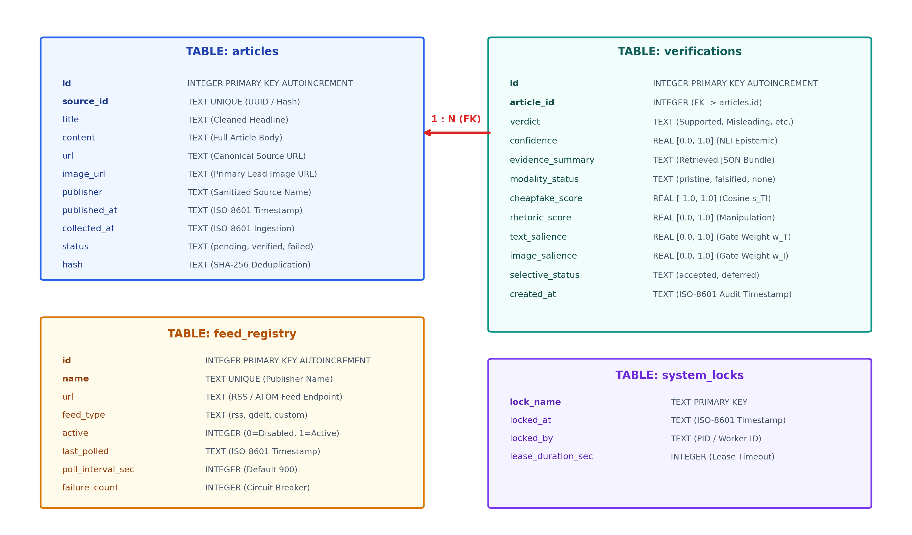

# SQLite Database Design & Concurrency Architecture

## VERITAS-MM 2.0: ACID Persistence Engine (`data/news_intelligence.db`)

---

## 1. Overview & Operational Requirements

VERITAS-MM 2.0 requires persistent storage capable of handling continuous real-time news ingestion from national and global feeds while concurrently serving interactive verification queries on the Streamlit dashboard. 

The storage architecture is designed to satisfy four strict operational constraints:
1. **Zero External Daemon Dependencies:** Embedded SQLite 3 storage eliminates the operational complexity of managing external PostgreSQL or Redis servers on analyst laptops.
2. **ACID Transactional Guarantees:** Ensures that multi-table inserts (articles + verifications) commit atomically or roll back cleanly upon failure.
3. **Non-Blocking Concurrent Operations:** Ingestion threads can append new articles without blocking user dashboard queries.
4. **Strict Content Deduplication:** SHA-256 hash digests prevent duplicate syndication articles from flooding verification queues.



---

## 2. Relational Schema Specification

### Table 1: `articles`
Stores raw and normalized news articles ingested from RSS/Atom feeds, GDELT 2.0 API, or manual analyst submission.

```sql
CREATE TABLE IF NOT EXISTS articles (
    id INTEGER PRIMARY KEY AUTOINCREMENT,
    source_id TEXT UNIQUE,
    title TEXT NOT NULL,
    content TEXT,
    url TEXT NOT NULL,
    image_url TEXT,
    publisher TEXT NOT NULL,
    published_at TEXT,
    collected_at TEXT NOT NULL,
    status TEXT NOT NULL DEFAULT 'pending',
    hash TEXT NOT NULL UNIQUE
);

CREATE INDEX IF NOT EXISTS idx_articles_status ON articles(status);
CREATE INDEX IF NOT EXISTS idx_articles_publisher ON articles(publisher);
CREATE INDEX IF NOT EXISTS idx_articles_published_at ON articles(published_at);
CREATE INDEX IF NOT EXISTS idx_articles_hash ON articles(hash);
```

#### Field Specifications
* `id` (`INTEGER`): Auto-incrementing internal primary key.
* `source_id` (`TEXT UNIQUE`): External unique identifier (RSS GUID, URL slug, or UUID4).
* `title` (`TEXT`): Headline after Unicode normalization and whitespace trimming.
* `content` (`TEXT`): Full text body or RSS summary snippet.
* `url` (`TEXT`): Canonical destination URL of the original publication.
* `image_url` (`TEXT`): Direct HTTP/HTTPS link to the lead photographic asset.
* `publisher` (`TEXT`): Standardized publisher name (e.g., `"The Hindu"`, `"BBC News"`).
* `published_at` (`TEXT`): ISO-8601 publication timestamp parsed from feed metadata.
* `collected_at` (`TEXT`): ISO-8601 timestamp recording ingestion into the local store.
* `status` (`TEXT`): Lifecycle stage flag: `'pending'`, `'verified'`, `'processing'`, or `'failed'`.
* `hash` (`TEXT UNIQUE`): SHA-256 digest computed over `publisher + "::" + title`.

---

### Table 2: `verifications`
Stores multi-pillar epistemic adjudications, predictive telemetry, alignment scores, and retrieved evidence bundles.

```sql
CREATE TABLE IF NOT EXISTS verifications (
    id INTEGER PRIMARY KEY AUTOINCREMENT,
    article_id INTEGER NOT NULL,
    verdict TEXT NOT NULL,
    confidence REAL NOT NULL,
    evidence_summary TEXT,
    modality_status TEXT,
    cheapfake_score REAL,
    rhetoric_score REAL,
    text_salience REAL,
    image_salience REAL,
    selective_status TEXT NOT NULL DEFAULT 'accepted',
    created_at TEXT NOT NULL,
    FOREIGN KEY (article_id) REFERENCES articles(id) ON DELETE CASCADE
);

CREATE INDEX IF NOT EXISTS idx_verifications_article_id ON verifications(article_id);
CREATE INDEX IF NOT EXISTS idx_verifications_verdict ON verifications(verdict);
CREATE INDEX IF NOT EXISTS idx_verifications_created_at ON verifications(created_at);
```

#### Field Specifications
* `id` (`INTEGER`): Auto-incrementing primary key.
* `article_id` (`INTEGER`): Foreign key referencing `articles.id` with cascade deletion.
* `verdict` (`TEXT`): Final epistemic adjudication: `'SUPPORTED'`, `'PARTIALLY SUPPORTED'`, `'MISLEADING'`, `'CONFLICTING EVIDENCE'`, or `'UNCERTAIN'`.
* `confidence` (`REAL`): Directional NLI stance confidence score $\in [0.0, 1.0]$.
* `evidence_summary` (`TEXT`): Serialized JSON bundle containing retrieved source citations, proposition stances, and topical relevance metrics.
* `modality_status` (`TEXT`): OpenCLIP contextual alignment flag: `'pristine'`, `'falsified'`, or `'none'` (for text-only inputs).
* `cheapfake_score` (`REAL`): Cosine similarity score $s_{TI} \in [-1.0, 1.0]$.
* `rhetoric_score` (`REAL`): Gated fusion adapter manipulation probability $\in [0.0, 1.0]$.
* `text_salience` (`REAL`): Empirical scalar text gate weight $w_{\text{text}} \in [0.0, 1.0]$.
* `image_salience` (`REAL`): Empirical scalar vision gate weight $w_{\text{vision}} \in [0.0, 1.0]$.
* `selective_status` (`TEXT`): Chow's reject triage flag: `'accepted'` or `'deferred'`.
* `created_at` (`TEXT`): ISO-8601 audit timestamp.

---

### Table 3: `feed_registry`
Maintains operational health, polling intervals, and circuit breakers for registered RSS/Atom feeds.

```sql
CREATE TABLE IF NOT EXISTS feed_registry (
    id INTEGER PRIMARY KEY AUTOINCREMENT,
    name TEXT NOT NULL UNIQUE,
    url TEXT NOT NULL,
    feed_type TEXT NOT NULL DEFAULT 'rss',
    active INTEGER NOT NULL DEFAULT 1,
    last_polled TEXT,
    poll_interval_sec INTEGER NOT NULL DEFAULT 900,
    failure_count INTEGER NOT NULL DEFAULT 0
);
```

#### Circuit Breaker Logic
* `active`: Integer boolean flag (`1` = active, `0` = disabled).
* `failure_count`: Incremented on network timeout or HTTP 5xx responses. If `failure_count >= 3`, the background daemon temporarily suspends polling for that publisher and logs an operational alert.

---

### Table 4: `system_locks`
Provides distributed mutex synchronization across concurrent threads and background scheduler workers.

```sql
CREATE TABLE IF NOT EXISTS system_locks (
    lock_name TEXT PRIMARY KEY,
    locked_at TEXT NOT NULL,
    locked_by TEXT NOT NULL,
    lease_duration_sec INTEGER NOT NULL DEFAULT 60
);
```

#### Mutex Lease Mechanism
Before initiating an ingestion or batch verification cycle, the worker requests a lease:
```python
def acquire_lock(conn: sqlite3.Connection, lock_name: str, worker_id: str, lease_sec: int = 60) -> bool:
    now = datetime.utcnow().isoformat()
    cur = conn.cursor()
    # Purge expired leases
    cur.execute(
        "DELETE FROM system_locks WHERE lock_name = ? AND datetime(locked_at, '+' || lease_duration_sec || ' seconds') < datetime(?)",
        (lock_name, now)
    )
    # Attempt atomic insert
    try:
        cur.execute(
            "INSERT INTO system_locks (lock_name, locked_at, locked_by, lease_duration_sec) VALUES (?, ?, ?, ?)",
            (lock_name, now, worker_id, lease_sec)
        )
        conn.commit()
        return True
    except sqlite3.IntegrityError:
        return False
```

---

## 3. High-Performance Concurrency Tuning

Standard SQLite deployments often fail with `sqlite3.OperationalError: database is locked` when multi-threaded applications perform concurrent reads and writes. VERITAS-MM 2.0 configures optimal SQLite PRAGMA directives upon every connection initialization:

```python
def get_db_connection(db_path: Path) -> sqlite3.Connection:
    conn = sqlite3.connect(str(db_path), timeout=10.0)
    conn.execute("PRAGMA journal_mode = WAL;")        # Write-Ahead Logging
    conn.execute("PRAGMA synchronous = NORMAL;")       # Safe disk flush on checkpoint
    conn.execute("PRAGMA busy_timeout = 5000;")        # 5-second automatic retry on locks
    conn.execute("PRAGMA foreign_keys = ON;")          # Enforce relational integrity
    conn.row_factory = sqlite3.Row                     # Name-based column access
    return conn
```

### Why WAL (Write-Ahead Logging) Mode?
1. **Concurrent Reads and Writes:** In default rollback journal mode, writing locks the entire database file against readers. Under WAL mode, readers query the database file while writes append to a separate `-wal` log file. Readers and writers execute concurrently with zero blocking.
2. **Reduced I/O Overhead:** Small writes append sequentially to the WAL log; changes are merged back into the main database file during background checkpointing.
