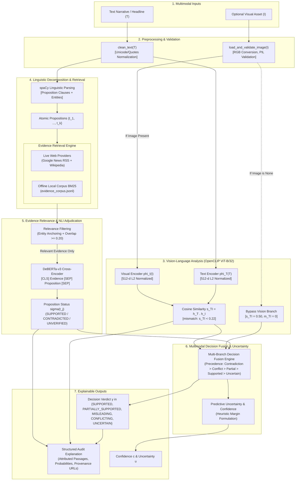

# Phase 1: Academic & Research Alignment Report
## MSc Research Project — Methodology and Architecture Specification

**Project Title:** Explainable Multimodal Vision-Language Framework for AI-Generated Fake News and Misinformation Detection  
**Degree Programme:** MSc Data Science Final-Year Research Project  
**Submission Workspace:** `C:\Users\94in\.gemini\antigravity\scratch\multimodal-misinfo-submission`  
**Protected Baseline Workspace:** `C:\Users\94in\.gemini\antigravity\scratch\multimodal-misinfo-verifier` (Verified Untouched)  
**Document Classification:** Academic Research Specification & Architectural Audit  
**Date:** October 13, 2026  
**Auditor / Lead ML Engineer:** Senior ML Verification Engineer (Google DeepMind Antigravity)

---

## 1. Executive Summary & Audit Scope

This document establishes the formal academic, mathematical, and experimental foundation for the MSc Data Science research project: *Explainable Multimodal Vision-Language Framework for AI-Generated Fake News and Misinformation Detection*. 

The primary objective of Phase 1 is to bridge the gap between the functional software prototype currently residing in the submission workspace and a rigorous MSc-level dissertation. In accordance with strict academic guidelines, this phase is **strictly read-only with respect to code execution**: no application source code has been altered, no dependencies installed, and no benchmark datasets prematurely downloaded.

Every component, mathematical formulation, and experimental design in this report is grounded in the actual codebase inspected on disk. Unimplemented features, heuristic baselines, and future trainable components are explicitly demarcated to preserve academic integrity.

---

## 2. Task 1: Audit of the Current Implementation

The current submission repository is structured as a modular pipeline combining open-weight NLP and computer vision models with retrieval mechanisms and heuristic aggregation rules. Table 2.1 presents a rigorous audit of every subsystem, classified into one of four standard engineering states:
1. **Implemented & Verified in Code:** Tested, operational, and supported by passing regression tests.
2. **Partially Implemented:** Functional in core paths, but missing full generality or dependent on fallbacks.
3. **Demonstration / Heuristic Implementation:** Rule-based, threshold-based, or synthetic approximations serving as baseline scaffolding.
4. **Planned but Not Implemented:** Stubbed interfaces, missing models, or future research extensions.

### Table 2.1: Comprehensive Component Audit Matrix

| Subsystem / Component | Source File & Primary Function / Class | Implementation Status | Technical Reality & Evidence |
| :--- | :--- | :--- | :--- |
| **Text Normalization & Preprocessing** | [`src/preprocess.py`](file:///C:/Users/94in/.gemini/antigravity/scratch/multimodal-misinfo-submission/src/preprocess.py)<br>`clean_text()` | **Implemented & Verified** | Cleans typographic quotes, em-dashes, whitespace, and Unicode artifacts. Verified in `test_submission_pipeline.py`. |
| **Image Loading & Validation** | [`src/preprocess.py`](file:///C:/Users/94in/.gemini/antigravity/scratch/multimodal-misinfo-submission/src/preprocess.py)<br>`load_and_validate_image()` | **Implemented & Verified** | Validates PIL readability, converts to RGB, flags corrupt files. Verified in `test_image_loading_and_cross_modal()`. |
| **Atomic Claim Decomposition** | [`src/decomposition.py`](file:///C:/Users/94in/.gemini/antigravity/scratch/multimodal-misinfo-submission/src/decomposition.py)<br>`decompose_claim()`, `split_into_clauses()` | **Partially Implemented** | Deterministic linguistic baseline using `spaCy` (`en_core_web_sm`) and regex clause splitting (`split_into_clauses`). Extracts named entities, locations, and dates. Verified on compound sentences. Does not perform multi-hop discourse coreference resolution. |
| **Optical Character Recognition (OCR)** | [`src/ocr.py`](file:///C:/Users/94in/.gemini/antigravity/scratch/multimodal-misinfo-submission/src/ocr.py)<br>`extract_ocr_text()` | **Partially Implemented** | Wrapper for `easyocr`. Because `easyocr` is not installed in the Windows environment, it gracefully defaults to empty OCR (`has_text=False`). No text fabrication occurs. |
| **Vision-Language Alignment** | [`src/cross_modal.py`](file:///C:/Users/94in/.gemini/antigravity/scratch/multimodal-misinfo-submission/src/cross_modal.py)<br>`compute_cross_modal_consistency()` | **Implemented & Verified** | Uses pretrained OpenCLIP (`openai/clip-vit-base-patch32`). Computes cosine similarity between normalized $L_2$ image features and text features. Flags mismatches below cutoff $\tau_{\text{cm}} = 0.22$. Tokenizes full text with `truncation=True, max_length=77`. |
| **AI-Generated Image Detection** | *None* | **Planned but Not Implemented** | **CRITICAL GAP:** The project synopsis mentions "AI-Generated Fake News", but the codebase contains **zero** synthetic image / diffusion / GAN artifact detectors. It only measures semantic image-text mismatch. |
| **Local Corpus Retrieval** | [`src/retrieval.py`](file:///C:/Users/94in/.gemini/antigravity/scratch/multimodal-misinfo-submission/src/retrieval.py)<br>`SimpleBM25` | **Demonstration / Heuristic** | Custom token-level BM25Okapi implementation. Indexes `data/corpus/evidence_corpus.jsonl` which contains only 6 synthetic demo documents. Operates as an offline fallback. |
| **Live Web Evidence Retrieval** | [`src/evidence_providers.py`](file:///C:/Users/94in/.gemini/antigravity/scratch/multimodal-misinfo-submission/src/evidence_providers.py)<br>`GoogleNewsRSSProvider`, `WikipediaSearchProvider` | **Implemented & Verified** | Live HTTP search over Google News RSS and MediaWiki API. Implements in-memory TTL caching (`cache_ttl_seconds=3600`) and Wikipedia 429 rate limit backoff. Tested in live smoke tests. |
| **Article Scraping & Resolution** | [`src/article_fetcher.py`](file:///C:/Users/94in/.gemini/antigravity/scratch/multimodal-misinfo-submission/src/article_fetcher.py)<br>`fetch_article_content()`, `resolve_publisher_url()` | **Implemented & Verified** | BeautifulSoup extraction of article bodies. Implements homepage refusal (`is_root_or_homepage_url()`) and safe wrapper resolution. Tested in `test_phase_p0_fixes.py`. |
| **Evidence Relevance Scoring** | [`src/retrieval.py`](file:///C:/Users/94in/.gemini/antigravity/scratch/multimodal-misinfo-submission/src/retrieval.py)<br>`evaluate_evidence_relevance()` | **Demonstration / Heuristic** | Lexical overlap and entity anchor matching heuristic. Requires entity match + token overlap $\ge \tau_{\text{rel}} = 0.20$. Prevents irrelevant passages from polluting NLI. Not a dense neural cross-encoder ranker. |
| **Natural Language Inference (NLI)** | [`src/verification.py`](file:///C:/Users/94in/.gemini/antigravity/scratch/multimodal-misinfo-submission/src/verification.py)<br>`estimate_nli_relation()` | **Implemented & Verified** | Pretrained DeBERTa-v3 cross-encoder (`MoritzLaurer/DeBERTa-v3-base-mnli-fever-anli`). Formats pairs as `[CLS] Evidence [SEP] Claim [SEP]`. Maps `{0: entailment, 1: neutral, 2: contradiction}`. Verified in `test_nli_diagnostic.py`. |
| **Granular Atomic Verification** | [`src/verification.py`](file:///C:/Users/94in/.gemini/antigravity/scratch/multimodal-misinfo-submission/src/verification.py)<br>`verify_atomic_claims()` | **Implemented & Verified** | Iterates over propositions, retrieves targeted evidence, evaluates NLI, assigns per-claim status (`SUPPORTED`, `CONTRADICTED`, `CONFLICTING`, `UNVERIFIED`). |
| **Decision Fusion Engine** | [`src/verification.py`](file:///C:/Users/94in/.gemini/antigravity/scratch/multimodal-misinfo-submission/src/verification.py)<br>`fuse_multimodal_decision()`, `aggregate_atomic_verifications()` | **Demonstration / Heuristic** | Deterministic rule table fusing atomic statuses and CLIP mismatch flag into 5 discrete verdicts. Not a learned neural classifier or probabilistic graphical model. |
| **Uncertainty & Confidence** | [`src/uncertainty.py`](file:///C:/Users/94in/.gemini/antigravity/scratch/multimodal-misinfo-submission/src/uncertainty.py)<br>`compute_decision_confidence_and_uncertainty()` | **Demonstration / Heuristic** | Linear heuristic blending NLI margin and CLIP margin: $c = 0.50 + 0.25 \cdot \text{margin}_{\text{cm}} + 0.25 \cdot \text{margin}_{\text{nli}}$, $u = 1 - c$. Not formal conformal prediction or Bayesian calibration. |
| **Attribution & Explanation** | [`src/explainability.py`](file:///C:/Users/94in/.gemini/antigravity/scratch/multimodal-misinfo-submission/src/explainability.py)<br>`generate_structured_explanation()` | **Implemented & Verified** | Deterministic structured text reporting primary decision factors, atomic proposition findings, citations $[doc\_id]$, and provenance. |
| **External LLM Reasoning Hook** | [`src/optional_llm.py`](file:///C:/Users/94in/.gemini/antigravity/scratch/multimodal-misinfo-submission/src/optional_llm.py)<br>`OptionalLLMProvider` | **Planned but Not Implemented** | Unactivated stub interface for optional Gemini API integration. Core framework runs 100% locally on CPU without external API dependencies. |
| **Benchmark Ingestion Loaders** | [`src/data_loader.py`](file:///C:/Users/94in/.gemini/antigravity/scratch/multimodal-misinfo-submission/src/data_loader.py)<br>`load_newsclippings()`, `validate_factify2_record()` | **Partially Implemented** | Ingestion schemas and label normalizers implemented for NewsCLIPpings and Factify 2. No full datasets are currently downloaded into `data/raw`. Uses 5 synthetic demo samples. |

---

## 3. Task 2: Formal Research Problem Formulation

### 3.1 Background & Motivation

The proliferation of online misinformation represents a multifaceted threat to democratic discourse, public health, and societal stability. Modern misinformation rarely consists of isolated plain-text fabrications. Instead, contemporary disinformation campaigns exploit multimodal synergies: pairing evocative, authentic visual assets with misleading textual claims (termed *cheapfakes* or *out-of-context imagery*), fabricating entirely synthetic assertions, or deploying generative AI models to manufacture photorealistic imagery (*deepfakes*).

Detecting multimodal misinformation introduces severe methodological challenges:
1. **Modality Asymmetry:** Visual assets often contain ambiguous semantic meaning without captions, while captions derive their perceived credibility from accompanying imagery.
2. **The "Out-of-Context" Problem:** The image itself may be completely unaltered (e.g., a real photograph of a past protest), but the accompanying headline attributes it to an ongoing, unrelated event.
3. **Absence of Evidence vs. Evidence of Absence:** An unverifiable claim cannot be presumed false simply because a search engine returns no results. Epistemic conservatism requires distinguishing between claims *refuted* by evidence and claims *unsupported* due to information scarcity.
4. **Black-Box Opacity:** End-to-end neural classifiers that output a single binary "fake" probability offer no inspectable audit trail, undermining user trust and academic utility.

### 3.2 Formal Categorization: Three Distinct Research Tasks

To prevent conceptual confusion, the research framework establishes strict boundaries between three related but fundamentally distinct technical tasks:

```
┌────────────────────────────────────────────────────────────────────────────────────────┐
│                        MULTIMODAL INFORMATION INTEGRITY TASKS                          │
├──────────────────────────────┬─────────────────────────────┬───────────────────────────┤
│ 1. Factual Claim Verification│ 2. Cross-Modal Consistency  │ 3. Synthetic Image        │
│    (Evidence Grounding)      │    (Cheapfake Detection)    │    Forensics (Deepfakes)  │
├──────────────────────────────┼─────────────────────────────┼───────────────────────────┤
│ • Focus: Text-Evidence       │ • Focus: Image-Text Semantic│ • Focus: Pixel / Frequency│
│   truth-conditional relations│   congruence / context      │   generative artifacts    │
│ • Models: Retrieval (BM25,   │ • Models: Vision-Language   │ • Models: Spatial CNNs,   │
│   Search API) + NLI Cross-   │   dual-encoders (CLIP,      │   frequency spectrum      │
│   Encoder (DeBERTa-v3)       │   ALIGN)                    │   classifiers             │
│ • State: IMPLEMENTED         │ • State: IMPLEMENTED        │ • State: NOT IMPLEMENTED  │
└──────────────────────────────┴─────────────────────────────┴───────────────────────────┘
```

> [!IMPORTANT]
> **Scope Clarification Regarding "AI-Generated Fake News":**  
> While the thesis synopsis mentions "AI-Generated Fake News", the current system **does not inspect pixel grids for diffusion or GAN artifacts**. It addresses the multimodal misinformation challenge via *vision-language semantic alignment* and *evidence-grounded factuality verification*. A candidate deepfake image will be evaluated on whether its semantic content aligns with the text claim and whether the asserted event is corroborated by external evidence. Adding a dedicated spatial-frequency synthetic image classifier is documented as future research work.

### 3.3 Research Objectives & Questions

#### Primary Objective
To design, implement, and evaluate an explainable, modular, evidence-augmented multimodal verification framework that jointly assesses visual-textual consistency, decomposes complex narrative assertions into verifiable propositions, grounds assertions against external web knowledge, and outputs calibrated, transparent adjudication reports.

#### Research Questions (RQs)
- **RQ1 (Decomposition Efficacy):** Does decomposing complex news claims into atomic propositions via dependency parsing improve verification precision and prevent false refutations compared to sentence-level verification?
- **RQ2 (Cross-Modal Discriminability):** To what extent does dual-encoder vision-language alignment (OpenCLIP cosine distance) discriminate between genuine news imagery and out-of-context cross-modal falsifications (*cheapfakes*)?
- **RQ3 (Retrieval Robustness):** Can hybrid evidence retrieval (combining lexical indexing with live web queries) ground arbitrary news assertions without suffering from confirmation bias or domain-specific overfitting?
- **RQ4 (Decision Fusion & Epistemic Uncertainty):** How effectively do multi-branch rule-based aggregation and explicit uncertainty estimation separate genuinely refuted falsehoods from uncorroborated assertions?
- **RQ5 (Explainability Faithfulness):** Do structured, evidence-cited attribution reports provide faithful, human-interpretable justifications of automated verification decisions?

### 3.4 Target Label Space & Epistemic Decision Logic

The framework rejects simple binary classification (Real vs. Fake). Binary labels conflate unverified claims with proven fabrications. Instead, the system outputs one of five discrete epistemic verdicts:

1. **`SUPPORTED` ($\mathcal{Y}_{\text{sup}}$):** All atomic propositions $t_j \in T$ are substantiated by credible retrieved evidence ($p_{\text{entail}} \ge \tau_{\text{ent}}$), and the visual asset (if present) exhibits consistent semantics ($s_{TI} \ge \tau_{\text{cm}}$).
2. **`PARTIALLY_SUPPORTED` ($\mathcal{Y}_{\text{part}}$):** Core factual assertions are corroborated by evidence, but peripheral details are unverified; OR textual assertions are verified, but the accompanying visual is semantically mismatched (indicating an out-of-context or repurposed visual).
3. **`MISLEADING` ($\mathcal{Y}_{\text{mis}}$):** At least one atomic proposition is explicitly contradicted by credible retrieved evidence ($p_{\text{contra}} \ge \tau_{\text{contra}}$).
4. **`CONFLICTING` ($\mathcal{Y}_{\text{conf}}$):** Credible retrieved evidence sources materially disagree, with one source entailing and another refuting the assertion.
5. **`UNCERTAIN` ($\mathcal{Y}_{\text{unc}}$):** Retrieved evidence is missing, neutral, or fails topical relevance thresholds. The assertion cannot be verified given available information.

---

## 4. Task 3: Mathematical Formulation

### 4.1 Input Space & Representations

Let a multimodal news assertion sample be defined as a tuple:
$$\mathcal{S} = (T, I)$$
where $T \in \mathcal{V}^*$ is a textual claim of arbitrary token length, and $I \in \mathbb{R}^{H \times W \times 3} \cup \{\emptyset\}$ is an optional visual asset (RGB image). When no image is provided, $I = \emptyset$.

#### 1. Text Preprocessing & Atomic Decomposition
The raw text $T$ is normalized via a string cleaning transformation $T' = \text{clean}(T)$. A deterministic linguistic decomposition operator $\mathcal{D}$ segments $T'$ into a set of $k$ atomic propositions:
$$\mathcal{D}(T') = \{t_1, t_2, \ldots, t_k\}, \quad k \ge 1$$
where each proposition $t_j$ is associated with extracted named entities $\mathcal{E}_j = \{e_{j,1}, \ldots, e_{j,m}\}$.

#### 2. Vision-Language Semantic Representations
The visual asset $I$ and full text $T'$ are projected into a shared $d$-dimensional embedding space ($d = 512$ for OpenCLIP ViT-B/32) using dual neural encoders:
$$h_T = \phi_T(T') \in \mathbb{R}^d, \quad h_I = \begin{cases} \phi_I(I) \in \mathbb{R}^d & \text{if } I \neq \emptyset \\ \emptyset & \text{if } I = \emptyset \end{cases}$$
Representations are normalized onto the unit hypersphere:
$$\hat{h}_T = \frac{h_T}{\|h_T\|_2}, \quad \hat{h}_I = \frac{h_I}{\|h_I\|_2}$$

The cross-modal semantic consistency score $s_{TI} \in [-1.0, 1.0]$ is computed via cosine similarity:
$$s_{TI} = \begin{cases} \hat{h}_T^\top \hat{h}_I & \text{if } I \neq \emptyset \\ s_{\text{default}} = 0.50 & \text{if } I = \emptyset \end{cases}$$

A binary cross-modal mismatch indicator $m_{TI} \in \{0, 1\}$ is defined with respect to an empirical cutoff threshold $\tau_{\text{cm}} \in (0, 1)$:
$$m_{TI} = \begin{cases} \mathbb{I}(s_{TI} < \tau_{\text{cm}}) & \text{if } I \neq \emptyset \\ 0 & \text{if } I = \emptyset \end{cases}$$
where $\mathbb{I}(\cdot)$ is the indicator function. When $I = \emptyset$, $m_{TI} = 0$, explicitly preventing text-only inputs from triggering visual mismatch flags.

### 4.2 Evidence Retrieval & Relevance Filtering

For each atomic proposition $t_j$, a retrieval query generator constructs targeted search queries $Q(t_j) = \{q_{j,1}, q_{j,2}, \ldots\}$. An external retrieval operator $\mathcal{R}$ queries candidate evidence sources (Google News RSS, Wikipedia API, local BM25 index), returning candidate passages:
$$\mathcal{E}_j = \mathcal{R}(Q(t_j)) = \{e_{j,1}, e_{j,2}, \ldots, e_{j,M}\}$$

Each candidate passage $e_{j,i}$ is evaluated by an entity-anchored lexical relevance operator $r(t_j, e_{j,i}) \in [0.0, 1.0]$:
$$r(t_j, e_{j,i}) = \alpha \cdot \text{Jaccard}(t_j, e_{j,i}) + \beta \cdot \text{EntityOverlap}(\mathcal{E}_j, e_{j,i})$$
A passage is qualified as relevant if it contains at least one matching entity anchor and meets cutoff $\tau_{\text{rel}} = 0.20$:
$$\text{Rel}(t_j, e_{j,i}) = \mathbb{I}(r(t_j, e_{j,i}) \ge \tau_{\text{rel}} \land |\mathcal{E}_j \cap \text{Entities}(e_{j,i})| \ge 1)$$

Candidate passages failing $\text{Rel}(t_j, e_{j,i}) = 1$ are excluded from truth-relation estimation to prevent irrelevant topical drift from corrupting downstream NLI inference.

### 4.3 Claim-Evidence Natural Language Inference

For each qualified passage $e_{j,i}$ where $\text{Rel}(t_j, e_{j,i}) = 1$, a cross-encoder model $\psi_{\text{NLI}}$ (DeBERTa-v3-base fine-tuned on MNLI/FEVER/ANLI) evaluates the directional entailment relation. The input is tokenized as a premise-hypothesis pair:
$$\mathbf{x}_{j,i} = [\text{CLS}] \circ e_{j,i} \circ [\text{SEP}] \circ t_j \circ [\text{SEP}]$$
The network outputs unnormalized logits $\mathbf{z}_{j,i} = [z_{\text{ent}}, z_{\text{neu}}, z_{\text{contra}}]^\top \in \mathbb{R}^3$. Softmax normalization yields probability simplex vectors:
$$\mathbf{p}_{j,i} = \text{Softmax}(\mathbf{z}_{j,i}) = [p_{\text{ent}}, p_{\text{neu}}, p_{\text{contra}}]^\top, \quad \sum_{c} p_c = 1.0$$

The proposition status $\sigma(t_j)$ is derived across its qualified evidence passages:
$$\sigma(t_j) = \begin{cases}
\text{CONFLICTING} & \text{if } \exists e_a, e_b \text{ s.t. } p_{\text{ent}}(e_a) \ge \tau_{\text{ent}} \land p_{\text{contra}}(e_b) \ge \tau_{\text{contra}} \\
\text{CONTRADICTED} & \text{if } \max_i p_{\text{contra}}(e_{j,i}) \ge \tau_{\text{contra}} \\
\text{SUPPORTED} & \text{if } \max_i p_{\text{ent}}(e_{j,i}) \ge \tau_{\text{ent}} \\
\text{UNVERIFIED} & \text{otherwise (neutral, uncorroborated, or no relevant evidence)}
\end{cases}$$
Default thresholds in code: $\tau_{\text{ent}} = 0.60, \tau_{\text{contra}} = 0.50$.

### 4.4 Decision Fusion & Uncertainty Estimation

#### 1. Discrete Verdict Fusion
The final verdict $y \in \{\mathcal{Y}_{\text{sup}}, \mathcal{Y}_{\text{part}}, \mathcal{Y}_{\text{mis}}, \mathcal{Y}_{\text{conf}}, \mathcal{Y}_{\text{unc}}\}$ is obtained via a deterministic multi-branch aggregation operator $\mathcal{F}$:

$$y = \mathcal{F}(\{\sigma(t_1), \ldots, \sigma(t_k)\}, m_{TI})$$

The precedence order enforced by $\mathcal{F}$ is:
1. **Contradiction / Conflict Precedence:**
   - If $\exists j \text{ s.t. } \sigma(t_j) = \text{CONFLICTING} \implies y = \mathcal{Y}_{\text{conf}}$.
   - If $\exists j \text{ s.t. } \sigma(t_j) = \text{CONTRADICTED} \implies y = \mathcal{Y}_{\text{mis}}$.
2. **Partial Corroboration:**
   - If $k > 1 \land \exists a, b \text{ s.t. } \sigma(t_a) = \text{SUPPORTED} \land \sigma(t_b) = \text{UNVERIFIED} \implies y = \mathcal{Y}_{\text{part}}$.
3. **Out-of-Context Visual Demotion:**
   - If $\forall j, \sigma(t_j) = \text{SUPPORTED}$, but $m_{TI} = 1$ (visual mismatch detected) $\implies y = \mathcal{Y}_{\text{part}}$ (text supported, but visual out-of-context).
4. **Full Corroboration:**
   - If $\forall j, \sigma(t_j) = \text{SUPPORTED} \land m_{TI} = 0 \implies y = \mathcal{Y}_{\text{sup}}$.
5. **Information Scarcity:**
   - If $\forall j, \sigma(t_j) = \text{UNVERIFIED} \implies y = \mathcal{Y}_{\text{unc}}$.

#### 2. Predictive Confidence & Uncertainty Formulation
The system computes an auditable predictive confidence score $c \in [0.0, 1.0]$ and complementary uncertainty score $u = 1.0 - c$.

In the current implementation, this is computed via a **heuristic linear margin blending formula**:
- Cross-modal margin: $\Delta_{\text{cm}} = \frac{|s_{TI} - \tau_{\text{cm}}|}{\max(\tau_{\text{cm}}, 1.0 - \tau_{\text{cm}})}$
- Evidence NLI margin: $\Delta_{\text{nli}} = \max(p_{\text{ent}}, p_{\text{contra}}) - p_{\text{neu}}$
- If $y = \mathcal{Y}_{\text{unc}} \implies c = 0.40, u = 0.60$.
- If $y = \mathcal{Y}_{\text{conf}} \implies c = 0.45, u = 0.55$.
- If $y = \mathcal{Y}_{\text{part}} \implies c = 0.65, u = 0.35$.
- Otherwise:
  $$c = \text{clip}\left(0.50 + 0.25 \cdot \min(1.0, \Delta_{\text{cm}}) + 0.25 \cdot \max(0.0, \min(1.0, \Delta_{\text{nli}})), 0.0, 1.0\right)$$
  $$u = 1.0 - c$$

> [!NOTE]
> **Heuristic vs. Calibrated Output:**  
> The existing uncertainty score $u$ is a **normalized heuristic margin index**, not a calibrated posterior probability $P(Y \neq y \mid \mathcal{S})$ or conformal prediction interval. Formulating and training a formal calibration layer (e.g. Temperature Scaling, Isotonic Regression, or Split Conformal Prediction) is specified as part of the Phase 2/3 research roadmap.

---

## 5. Task 4: Research Architecture

### 5.1 End-to-End System Architecture Diagram



### 5.2 Architectural Characteristics & Execution Modalities

1. **Decoupled Pretrained Modular Architecture:**  
   The framework is **not** an end-to-end backpropagation-trained unified neural network. It operates as an asynchronous, modular pipeline connecting frozen, open-weight foundation models (`OpenCLIP ViT-B/32`, `DeBERTa-v3-base-mnli-fever-anli`, `spaCy en_core_web_sm`) via typed Python contracts.
2. **Conditional Vision Branch Execution:**  
   When $I = \emptyset$ (text-only mode), the vision branch is completely bypassed:
   - No dummy image tensors are generated.
   - `cross_modal.details` reports `"No image provided; text-only evaluation mode"`.
   - The UI suppresses image alignment progress bars and displays an explicit text-only badge.
3. **Dual-Path Retrieval Pattern:**  
   Retrieval occurs at two granularities:
   - **Proposition-Specific Retrieval:** In `verify_atomic_claims()`, each proposition $t_j$ independently queries the retriever with entity-expanded search terms.
   - **Document-Level Retrieval:** In `pipeline.verify_sample()`, a top-k candidate set is indexed for global context and display in the Streamlit provenance expanders.

---

## 6. Task 5: Explainability Methodology

### 6.1 Current Explainability Architecture

The project adopts an **intrinsic, evidence-grounded attribution** philosophy rather than post-hoc saliency approximations. The explanation system in `src/explainability.py` synthesizes transparent audit trails consisting of four complementary signals:

1. **Evidence-Grounded Citations:**  
   Every atomic proposition is explicitly tied to the exact evidence document that corroborated or refuted it, citing the unique identifier (e.g., `[wiki_cc08f84019]`, `[live_fc7bc01c72]`), publisher domain, source URL, and extraction status.
2. **Component-Level Probability Signals:**  
   The report provides granular probability vectors from DeBERTa-v3 ($p_{\text{entail}}$, $p_{\text{neu}}$, $p_{\text{contra}}$) for each proposition-evidence pair, preventing opaque "black-box" verdicts.
3. **Cross-Modal Metric Transparency:**  
   The OpenCLIP cosine similarity score is rendered alongside the empirical cutoff threshold $\tau_{\text{cm}} = 0.22$, allowing human adjudicators to inspect whether a mismatch was borderline or severe.
4. **Deterministic Structured Synthesis:**  
   Explanations are assembled via deterministic template functions (`generate_structured_explanation`), completely avoiding generative LLM hallucinations.

### 6.2 Comparison with Model-Native & Post-Hoc Explainability

| Explainability Class | Technique | Current Implementation Status | Role in Proposed Research |
| :--- | :--- | :--- | :--- |
| **Evidence Grounding** | Cited snippet retrieval & URL provenance | **Fully Implemented** | Core thesis attribution mechanism. |
| **Proposition Attributions** | Granular atomic breakdown $\sigma(t_j)$ | **Fully Implemented** | Provides semantic granularity. |
| **Feature Attribution (Vision)** | Grad-CAM / Attention Rollout | **Planned for Phase 3** | Visual heatmaps showing which image regions caused CLIP mismatch. |
| **Feature Attribution (NLP)** | Integrated Gradients / SHAP | **Planned for Phase 3** | Token-level attributions highlighting which words drove NLI contradiction. |
| **Natural Language Explanations** | Generative LLM synthesis (Gemini hook) | **Stubbed (`optional_llm.py`)** | Optional narrative generation if API keys are provided. |

### 6.3 Explainability Evaluation Plan

To evaluate explainability academically, readability alone is insufficient. The research methodology will evaluate explanations across three rigorous dimensions:
1. **Faithfulness:** Measuring whether masking or perturbing the cited evidence passages directly alters the model's verdict (fidelity testing).
2. **Citation Precision & Recall:** Evaluating whether the retrieved snippets cited in explanations correspond to ground-truth evidence passages on annotated benchmark datasets (e.g., Factify 2 document annotations).
3. **Human Interpretability (User Study):** Assessing human adjudicator decision speed and agreement when provided with raw claims vs. structured evidence reports (5-point Likert scale measuring trust, transparency, and clarity).

---

## 7. Task 6: Research Novelty and Research Gap Analysis

### 7.1 Conservative Assessment of Contributions

In an MSc dissertation, claiming that individual standard techniques (CLIP embeddings, DeBERTa NLI, BM25 retrieval) are novel is academically unsound. The novelty of this research lies in the **holistic architectural integration, fine-grained epistemic reasoning, and transparent evidence-augmented adjudication**:

```
Existing Literature Baseline A:
Image + Caption ───► [Black-box Multimodal Classifier] ───► Binary Real/Fake (No Evidence, No Citations)

Existing Literature Baseline B:
Text Claim ───► [Fact-Checking Pipeline / FEVER] ───► Label (Ignores Visual Context & Cheapfakes)

Our Proposed Integrated Framework:
Text Claim ───► Atomic Decomposition ───► Targeted Retrieval ───► Directional NLI ──┐
                                                                                   ├──► Transparent Rule Fusion
Image Asset ──► OpenCLIP Dual-Encoder ──► Mismatch Thresholding ───────────────────┘    + Epistemic Uncertainty
                                                                                        + Structured Audit Report
```

#### Identified Research Contributions:
1. **Integration of Cross-Modal Alignment with Directional Fact Verification:** Prior work typically addresses either *cheapfake detection* (NewsCLIPpings) or *textual fact-checking* (FEVER). Our architecture unifies both, preventing out-of-context images from escaping scrutiny while ensuring factual assertions are externally corroborated.
2. **Epistemic Conservatism & Abstention:** Most benchmarks force a closed-world binary choice. Our framework introduces explicit `Uncertain` and `Conflicting` states with predictive uncertainty margins, allowing the system to abstain when evidence is absent rather than guessing.
3. **Granular Proposition-Level Verification:** By decomposing claims into propositions, the system avoids the "all-or-nothing" pitfall of sentence-level NLI, properly identifying *partially true* stories where the core event is real but specific details are unverified.
4. **Reproducible Local CPU Execution:** Demonstrating that verifiable, multi-stage multimodal verification can be achieved using open-weight foundation models locally on CPU without relying on proprietary, closed-source LLM APIs.

### 7.2 Research Gap Analysis

| Problem Dimension | Existing Approaches in Literature | Identified Research Gap | Proposed Solution in this Framework |
| :--- | :--- | :--- | :--- |
| **Evidence Grounding** | Large Vision-Language Models (LVLMs) hallucinate citations or rely on uninspectable parametric memory. | Absence of traceable, verifiable web URLs and snippet provenance. | External live retrieval with strict publisher provenance and non-hallucinatory template reporting. |
| **Out-of-Context Imagery** | End-to-end classification networks fail when a pristine image is paired with a false headline. | Models correlate visual features with specific domains rather than cross-modal discrepancy. | OpenCLIP hypersphere cosine distance thresholding decoupled from factual NLI. |
| **Information Scarcity** | Classifiers predict "fake" when search returns zero results (false negatives). | Conflation of "unproven" with "false". | Explicit three-state NLI mapping where neutral evidence defaults to `Uncertain` with high predictive uncertainty. |

### 7.3 Academic Literature & References

*Note: Verified academic citations are distinguished from suggested literature search areas.*

#### Verified Foundational Literature:
1. **Radford, A., et al. (2021).** *Learning Transferable Visual Models From Natural Language Supervision (CLIP).* ICML 2021. (Establishes the foundation for zero-shot vision-language alignment).
2. **He, P., et al. (2021).** *DeBERTaV3: Improving DeBERTa using ELECTRA-Style Pre-Training with Gradient-Disentangled Embedding Sharing.* arXiv:2111.09543. (Foundational NLI cross-encoder).
3. **Luo, G., et al. (2021).** *NewsCLIPpings: Automatic Generation of Out-of-Context Multimodal Media.* EMNLP 2021. (Standard benchmark for out-of-context news imagery).
4. **Mishra, S., et al. (2023).** *Factify 2: A Multimodal Fact Verification Dataset.* AAAI 2023 Workshop. (Standard multimodal fact-checking benchmark with 5-class labels).
5. **Thorne, J., et al. (2018).** *FEVER: a Large-scale Dataset for Fact Extraction and VERification.* NAACL 2018. (Foundational dataset for evidence-grounded NLI fact-checking).

#### Recommended Literature Review Search Topics for MSc Dissertation:
- *Multimodal Misinformation Detection & Cheapfakes:* Survey recent 2023–2025 papers on out-of-context image-caption verification.
- *Selective Classification & Conformal Prediction in NLP:* Survey conformal prediction frameworks (e.g., Angelopoulos & Bates) for guaranteed error-rate coverage in fact-checking.
- *Fact-Checking with Generative vs. Discriminative Models:* Review comparative studies between retrieval-augmented cross-encoders and generative LVLMs (e.g., GPT-4V, LLaVA) on factuality benchmarks.

---

## 8. Task 7: Benchmark and Experimental Design

### 8.1 Candidate Benchmark Datasets Evaluation

To evaluate the system empirically, candidate datasets must align with the distinct sub-tasks identified in Section 3.2. Table 8.1 evaluates three candidate benchmarks:

### Table 8.1: Candidate Benchmark Evaluation Matrix

| Dataset | Primary Task Evaluated | Modality & Labels | Current Code Compatibility | Required Adapter / Preprocessing | Evaluation Suitability |
| :--- | :--- | :--- | :--- | :--- | :--- |
| **NewsCLIPpings**<br>(Luo et al., 2021) | Out-of-context image detection (*cheapfakes*) | Image + Caption.<br>Binary: `pristine` (matching) vs. `falsified` (mismatched image). | **High.**<br>Existing loader in [`src/data_loader.py`](file:///C:/Users/94in/.gemini/antigravity/scratch/multimodal-misinfo-submission/src/data_loader.py#L108). | Direct compatibility with OpenCLIP branch. Ground truth maps to `cross_modal.mismatch_detected`. | **Recommended for RQ2 (Cross-Modal Alignment).** Evaluates visual-semantic alignment without external retrieval. |
| **Factify 2**<br>(Mishra et al., 2023) | Multimodal evidence-based fact verification | Claim (Text + Image) + Document (Text + Image).<br>5 classes: `Support_Multimodal`, `Support_Text`, `Insufficient_Multimodal`, `Refute`, `Neutral`. | **High.**<br>Schema validator and label map in [`src/data_loader.py`](file:///C:/Users/94in/.gemini/antigravity/scratch/multimodal-misinfo-submission/src/data_loader.py#L156). | Normalize 5 classes to framework's 5 verdicts via `normalize_factify2_label()`. | **Recommended for RQ1, RQ3, RQ4 (Full Pipeline).** Tests retrieval, NLI entailment, refutation, and evidence insufficiency. |
| **MMFakeBench**<br>(2024 / Recent) | Comprehensive multimodal fake news benchmark | Varied multimodal manipulation types (textual, visual, context). | **Medium / Exploratory.**<br>No native loader currently in codebase. | Requires downloading sample splits, inspecting schema, and writing custom adapter. | **Optional / Secondary.** Useful for cross-domain generalization if publicly downloadable. |

### 8.2 Proposed Metrics

The experimental evaluation will measure model performance across multiple complementary metrics:

1. **Classification Performance:**
   - **Macro-Averaged Precision, Recall, and F1-Score:** Essential due to class imbalance in misinformation datasets.
   - **Per-Class F1:** Specifically tracking performance on `MISLEADING` (refutations) vs. `UNCERTAIN` (abstentions).
   - **Accuracy & Balanced Accuracy:** For comparative benchmarking against published baselines.
   - **ROC-AUC & PR-AUC:** Evaluating ranking performance across continuous confidence thresholds $c \in [0, 1]$.
2. **Retrieval & Evidence Quality:**
   - **Mean Reciprocal Rank (MRR@k)** and **Hit@k ($k \in \{1, 3, 5\}$):** Measuring whether ground-truth evidence documents are retrieved in the top candidate pool.
   - **Relevance Precision:** Fraction of admitted evidence passages that satisfy topical entity constraints.
3. **Epistemic Abstention & Uncertainty Behavior:**
   - **Selective Accuracy / Risk-Coverage Curves:** Measuring accuracy improvements when the model is permitted to abstain on high-uncertainty claims ($u \ge \tau_u$).
   - **Expected Calibration Error (ECE):** Evaluating whether the heuristic confidence score $c$ matches empirical accuracy.

### 8.3 Baseline Models for Comparative Evaluation

The framework will be evaluated against representative competitive baselines:
1. **Majority Class / Random Baseline:** Naive control.
2. **Text-Only NLI Baseline (DeBERTa-v3):** Evaluates claims using evidence retrieval and NLI without visual inspection.
3. **Vision-Only Alignment Baseline (CLIP Cosine):** Evaluates claims purely on image-caption similarity without external evidence retrieval.
4. **Standard Supervised Multimodal Baseline:** A standard multimodal fusion model (e.g. CLIP embeddings passed to a linear classification head without retrieval).
5. **Full Proposed Evidence-Augmented Framework:** Combining atomic decomposition, hybrid retrieval, directional DeBERTa NLI, OpenCLIP alignment, and multi-branch decision fusion.

### 8.4 Ablation Study Design

To demonstrate the empirical utility of each architectural module, four systematic ablations will be conducted:
- **Ablation 1 (No Decomposition):** Verify the entire claim sentence as a single unit without atomic clause splitting. (Tests RQ1).
- **Ablation 2 (No Relevance Filtering):** Feed all top-k retrieved snippets directly to DeBERTa without entity-anchor relevance filtering. (Tests retrieval precision).
- **Ablation 3 (No Cross-Modal Visual Branch):** Execute in text-only mode on multimodal samples. (Tests the added value of visual context).
- **Ablation 4 (No Epistemic Abstention):** Force binary classification (Supported vs. Misleading) by eliminating `Uncertain` and `Partially Supported` states. (Tests error calibration).

### 8.5 Data Leakage Prevention & Reproducibility Protocol

- **Strict Split Isolation:** Train, validation, and test splits will be isolated. The retriever's local BM25 index must not index test set documents or ground-truth summaries.
- **Cache Isolation:** The query cache in `UniversalEvidenceRetriever` will be completely cleared between benchmark runs to prevent test-set memorization.
- **Deterministic Seeding:** Fixed random seeds (`seed: 42` configured in `config.yaml`) across all data splitters and PyTorch operations.
- **Hardware Consistency:** All benchmark inference runs will be executed under CPU-optimized batch settings, recording execution latency per sample.

---

## 9. Limitations & Implementation Gaps

To maintain strict academic honesty, the following known limitations and technical gaps are acknowledged:

1. **Absence of Synthetic Image Forensics:**  
   As established, the framework contains no frequency-domain or spatial CNN detectors for AI-generated images (Midjourney, DALL-E, Stable Diffusion). It identifies *out-of-context imagery*, not deepfakes.
2. **Google News CBMi JavaScript Redirects:**  
   Google News RSS wraps article URLs in encrypted tokens (`CBMi...`). Simple HTTP header resolution without a headless browser often fails to resolve the final publisher URL, restricting live articles to RSS headline snippets (`snippet_only`).
3. **Heuristic Confidence Bounds:**  
   Predictive uncertainty is calculated via a heuristic margin equation rather than a formally calibrated Bayesian or conformal prediction layer.
4. **Linguistic Dependency on English spaCy:**  
   Atomic claim decomposition relies on English dependency grammar. Multilingual news claims will require multilingual spaCy models (`xx_ent_wiki_sm`).
5. **OCR Engine Inactive on Host:**  
   `easyocr` is uninstalled in the host environment; OCR falls back to empty strings. Image overlay text is currently unread.

---

## 10. Prioritized Next Steps

With Phase 1 complete, the implementation and research roadmaps are aligned. The prioritized recommendations for Phase 2 are:

1. **Phase 2.1: Implement Dataset Ingestion Scripts:**
   - Connect `src/data_loader.py` to download or ingest standardized evaluation subsets (e.g. 50–200 validated samples) from NewsCLIPpings (out-of-context imagery) and Factify 2 (multimodal fact-checking).
2. **Phase 2.2: Build Evaluation Harness (`evaluate_benchmark.py`):**
   - Create a standalone evaluation script that iterates through benchmark samples, executes the pipeline, records predictions, and computes Accuracy, Precision, Recall, Macro F1, and confusion matrices.
3. **Phase 2.3: Execute Baseline Comparisons & Ablation Experiments:**
   - Run the automated ablation suite to generate concrete empirical tables for the dissertation results chapter.
